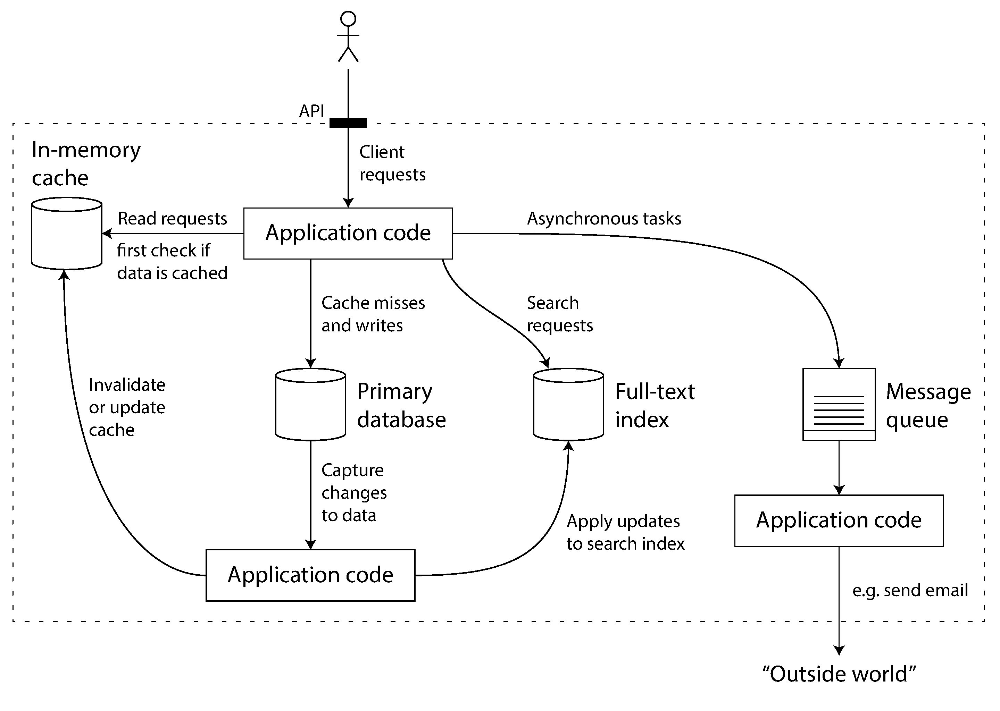
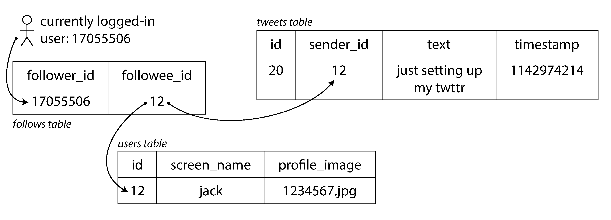
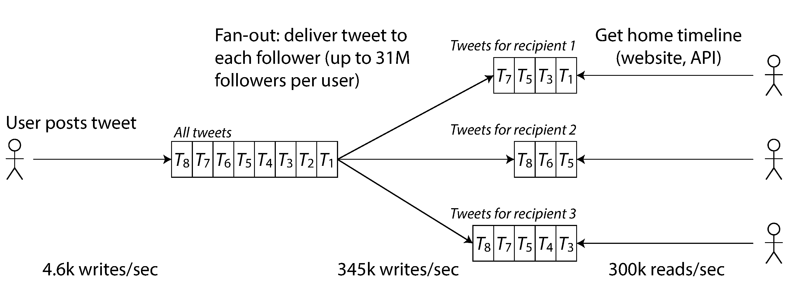
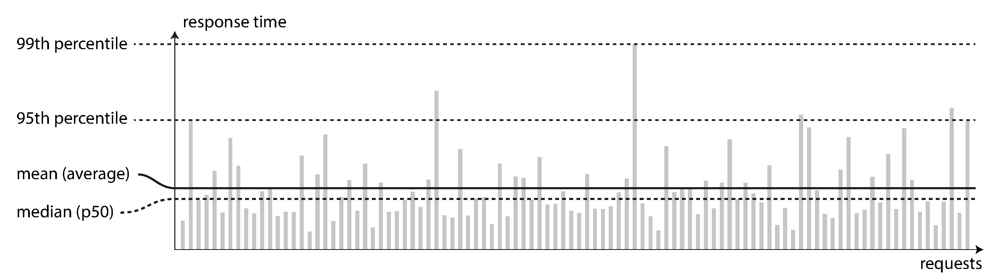
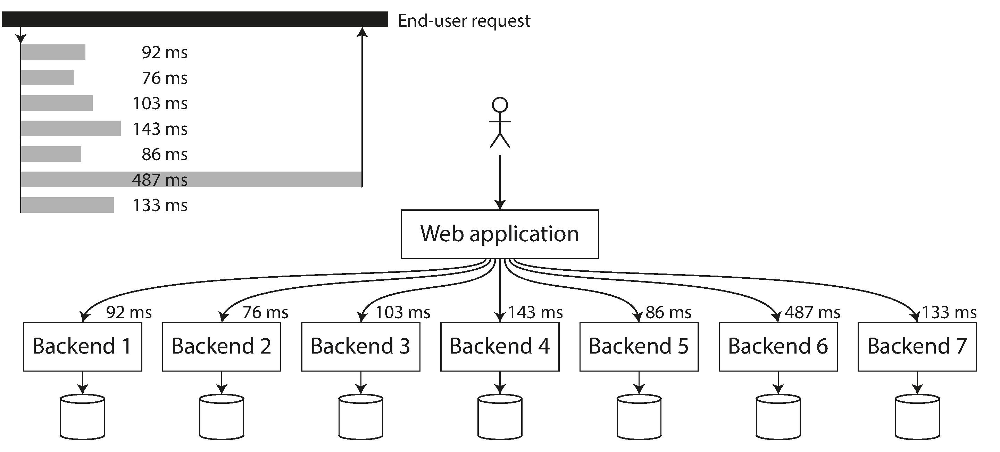

## Designing Data-Intensive Applications

### 1장. Reliable, Scalable, and Maintainable Applications

- 원문: 초판, 본문 pp. 3–23 / PDF pp. 25–45. 참고문헌은 PDF p. 45부터 시작함
- 핵심: 고장에 견디고, 부하 증가에 대응하며, 계속 운영·변경할 수 있는 시스템을 설계함
- 정비 관점: 장비 하나의 성능뿐 아니라 고장 격리, 작업량 증가, 인수인계까지 함께 보는 문제와 유사함

 

#### Thinking About Data Systems — 여러 도구를 하나의 시스템으로 보기

- 데이터 중심 애플리케이션은 계산량보다 데이터의 양·복잡도·변화 속도가 주된 문제가 됨
- database는 원본 저장, cache는 재사용, search index는 검색, queue는 작업 전달, batch·stream processor는 데이터 가공을 담당함
- 이들을 연결하는 코드도 데이터 시스템의 일부임. 한 도구의 정확성만으로 전체 데이터의 정확성이 보장되지는 않음
- 원본 기록과 작업 현황판을 함께 운영하듯, 어느 기록이 기준이고 변경이 어디까지 전달됐는지 정해야 함

 

#### Reliability — 문제가 생겨도 올바르게 동작하기

- reliability는 예상한 기능·성능·보안을 유지하는 성질임
- fault는 일부 구성 요소의 이상, failure는 시스템이 사용자에게 필요한 서비스를 제공하지 못하는 상태임
- 부품 고장이 전체 기능 상실로 번지지 않게 격리하는 것처럼, fault를 가정하고 failure를 줄여야 함

##### Hardware Faults — 물리적 고장

- disk, memory, 전원, network 장비는 고장날 수 있음
- RAID, 이중 전원 등은 개별 부품 고장의 영향을 줄임
- 장비 수가 많아지면 장비 전체의 손실도 일상적인 조건이 됨. 다른 장비로 처리를 넘길 수 있는 소프트웨어 설계가 필요함
- 이중화는 복구 수단의 일부임. 같은 전원이나 장소를 공유하면 여러 장비가 함께 영향을 받을 수 있음

##### Software Errors — 같은 오류가 여러 곳에서 발생하는 문제

- 특정 입력에 의한 crash, 자원 고갈, 느린 의존 서비스, 연쇄 장애가 대표적임
- 같은 코드와 가정을 공유하므로 장비를 여러 대 둬도 같은 오류가 동시에 발생할 수 있음
- 가정 검토, 테스트, 프로세스 격리, 재시작·복구, 운영 중 상태 관측을 함께 적용함

##### Human Errors — 실수를 견디는 운영

- 사람의 주의력만으로 오류를 막기 어려움. 올바른 조작이 쉬운 API와 관리 화면이 필요함
- production과 분리한 시험 환경, 단계적 배포, rollback, 재계산 수단으로 영향과 복구 시간을 줄임
- 정비 작업의 식별·확인·복구 절차처럼, 누가 작업해도 상태와 변경 이력을 확인할 수 있어야 함

##### How Important Is Reliability? — 필요한 수준 결정

- 일반 업무·쇼핑·개인 기록도 사용자에게 중요한 서비스임
- 신뢰성 수준은 장애의 영향과 비용을 비교해 결정함
- 비용 때문에 일부 위험을 수용할 수 있지만, 어떤 데이터와 기능을 잃을 수 있는지는 명시해야 함

 

#### Scalability — 부하 증가에 대응하기

- scalability는 특정 부하가 늘 때 성능을 유지할 수 있는 대응 전략임
- 먼저 무엇이 늘어나는지 정하고, 고정 자원에서의 성능 변화 또는 목표 성능에 필요한 자원 증가를 측정함

##### Describing Load — 작업량을 수치로 정의

- 초당 요청 수, 읽기·쓰기 비율, 동시 사용자, cache hit rate, 데이터 크기 등이 load parameter임
- 평균 작업량뿐 아니라 일부 큰 요청이 만드는 병목도 봐야 함
- 책의 Twitter 사례는 2012년 발표 기준임. 현재 서비스의 구조나 수치를 뜻하지 않음

- 읽을 때 조합: 팔로우한 사람들의 게시물을 조회해 합침. 쓰기는 단순하지만 읽기가 비싸짐
- 쓸 때 fan-out: 게시 시 팔로워별 타임라인에 미리 넣음. 읽기는 싸지만 팔로워가 많은 계정의 쓰기가 커짐
- 책의 사례는 두 방식을 섞음. 요청 수뿐 아니라 팔로워 수의 분포가 설계를 좌우함

##### Describing Performance — 평균과 지연 분포 구분

- batch 작업은 단위 시간당 처리량인 throughput, 온라인 요청은 response time이 주된 지표가 됨
- response time은 사용자가 관측하는 전체 응답 시간임. 책은 latency를 처리 대기 시간이라는 좁은 의미로 구분함
- p50은 요청의 절반, p95는 95%, p99는 99%가 그 시간 이내에 응답한다는 의미임
- p99가 크면 소수 요청이 매우 느릴 수 있음. 평균만으로는 이 상태를 파악하기 어려움

- 한 요청이 여러 backend 응답을 기다리면 그중 하나의 지연이 전체 응답을 늦춤. 이를 tail latency amplification이라고 함
- 장비·시간 구간별 percentile을 단순 평균하면 전체 percentile이 되지 않음. 합칠 수 있는 분포 자료가 필요함
- 부하 시험에서는 응답이 느려져도 원래 의도한 요청 발생률을 유지하는지 확인해야 함. 대기 때문에 요청 자체가 줄면 대기열 영향을 놓칠 수 있음

##### Approaches for Coping with Load — 확장 방식 선택

- scale up은 한 장비의 자원을 늘리고, scale out은 여러 장비에 일을 나눔
- 실제 구조는 두 방식을 조합할 수 있음. 자동 확장은 부하 변동에 대응하지만 운영 복잡도도 생김
- 상태가 없는 서비스보다 상태가 있는 database의 분산이 어려움. 데이터 위치·복제·일관성까지 맞춰야 하기 때문임
- 설계는 읽기량·쓰기량·응답 시간·접근 패턴에 따라 달라짐. 확인되지 않은 미래 규모만으로 복잡도를 늘리지 않음

 

#### Maintainability — 계속 운영하고 바꿀 수 있게 만들기

- 유지보수에는 장애 조사, 보안·플랫폼 변경, 기능 추가, 기술 부채 정리가 포함됨
- 정비성이 작업 접근성·점검성·교체성에 영향을 받듯, 소프트웨어도 운영·이해·변경이 쉬워야 함

##### Operability: Making Life Easy for Operations — 운영성

- 상태 관측, 원인 조사, 배포·설정 관리, 용량 계획, 복구를 쉽게 수행할 수 있어야 함
- 반복 작업을 자동화하고, 필요할 때 수동 개입할 수 있어야 함
- 특정 담당자의 기억에 의존하지 않도록 동작 원리와 운영 지식을 남김

##### Simplicity: Managing Complexity — 복잡도 관리

- 강한 결합, 얽힌 의존성, 불명확한 이름, 예외 처리 누적은 변경과 장애 조사를 어렵게 함
- 목표는 기능을 없애는 것이 아니라 구현 때문에 생긴 불필요한 복잡도를 줄이는 것임
- 좋은 abstraction은 내부 세부사항을 숨기면서 사용자가 의존할 수 있는 명확한 규칙을 제공함

##### Evolvability: Making Change Easy — 변경 용이성

- 요구사항과 사용 환경은 계속 바뀜. 데이터 모델과 시스템 경계도 변경 대상임
- 테스트와 refactoring을 활용하고, 여러 서비스·저장소가 함께 바뀌는 경로도 고려함
- 단순한 구조와 명확한 abstraction이 변경의 영향을 파악하기 쉽게 함

 

#### Summary — 정리

- reliability: 고장을 예상하고 서비스 실패로 번지는 경로를 줄임
- scalability: 부하와 성능을 먼저 측정한 뒤 자원을 배치함
- maintainability: 운영자가 상태를 확인하고 개발자가 안전하게 변경할 수 있게 함
- 이후 장은 이 세 목표 사이의 비용과 선택을 구체적인 데이터 구조·분산 처리 방식으로 설명함
