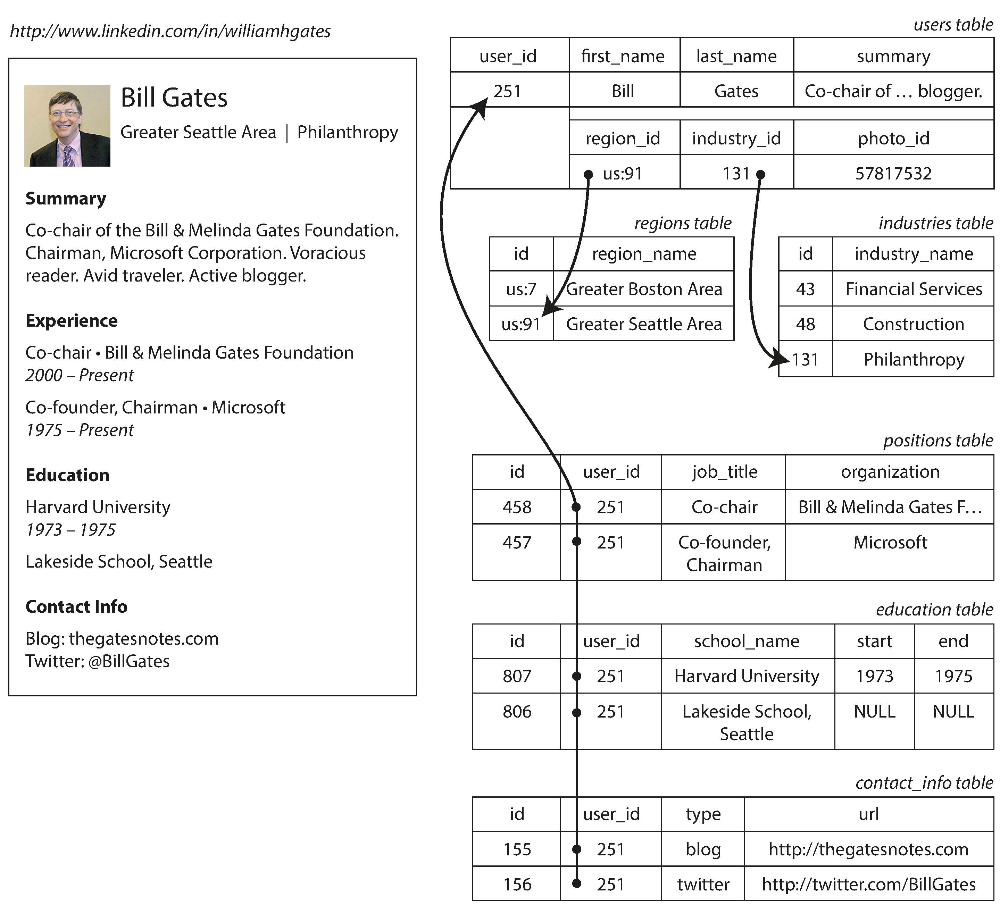
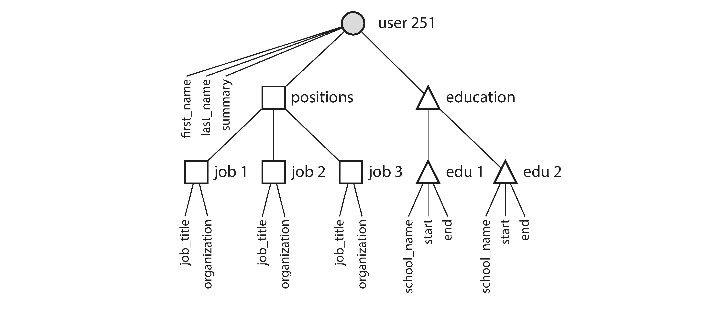
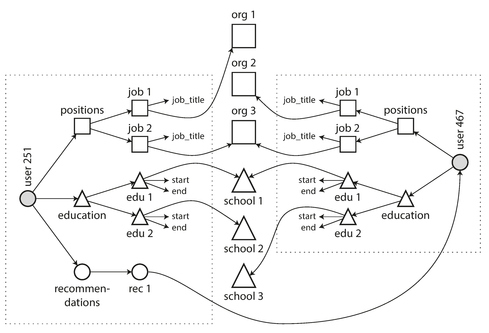
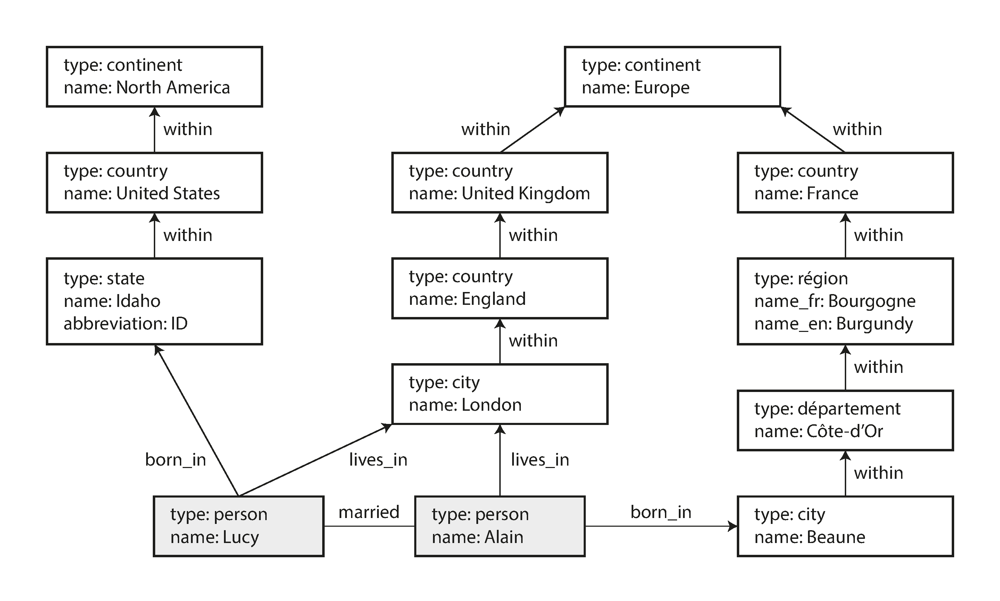
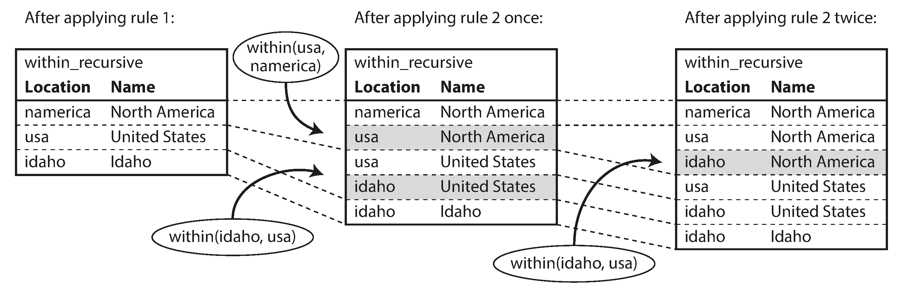

## Designing Data-Intensive Applications

### 2장. Data Models and Query Languages

- 원문: 초판, 본문 pp. 27–64 / PDF pp. 49–86. 참고문헌은 PDF p. 86부터 시작함
- 핵심: 데이터의 연결 관계와 조회 방식에 맞는 모델을 선택함
- 정비 관점: 항공기·부품·장탈착·결함 이력을 어떤 단위로 기록하고 연결할지 정하는 문제와 유사함

 

#### Relational Model Versus Document Model — 관계형과 문서 모델

- relational model은 데이터를 table의 row로 표현하고, ID와 join으로 관계를 연결함
- document model은 관련 데이터를 JSON 같은 중첩 문서로 묶음
- 애플리케이션은 현실의 개체, 객체, 저장 모델, byte 표현이라는 여러 추상화 계층을 사용함. 모델 선택은 코드와 사고방식에도 영향을 줌

##### The Birth of NoSQL — 여러 요구에 맞춘 모델의 등장

- NoSQL은 단일 모델이나 제품이 아님. 확장성, 공개 소프트웨어, 특수 조회, 유연한 구조에 대한 요구에서 여러 방식이 등장함
- 한 모델이 모든 작업에 유리하지는 않음. 서로 다른 저장소를 함께 쓰는 polyglot persistence가 가능함

##### The Object-Relational Mismatch — 객체와 table 사이의 차이

- 애플리케이션 객체를 여러 table로 나누고 다시 합치는 과정에서 변환 코드가 생김. ORM은 이를 줄이지만 모델 차이를 없애지는 못함

- 이력서처럼 한 사람 아래 여러 학력·경력이 있는 one-to-many 데이터는 문서 하나로 표현하기 쉬움
- 정비 예로는 작업 한 건의 점검 항목을 묶는 방식임. 작업 전체를 함께 읽을 때 편리함

##### Many-to-One and Many-to-Many Relationships — 공유 정보와 다대다 관계

- 같은 이름을 여러 곳에 복사하기보다 ID로 참조하면 이름 변경과 중복 관리를 한곳에서 처리할 수 있음. 이것이 normalization의 주요 목적임

- 회사·학교를 공유하거나 사용자끼리 추천하면 문서 밖의 many-to-one·many-to-many 관계가 생김
- 부품 이력을 항공기 문서에만 넣으면 다른 항공기로 옮겨 장착한 이력을 연결하기 어려워짐. 독립된 부품 ID가 필요한 이유와 유사함
- 관계가 많아질수록 join 또는 애플리케이션의 추가 조회가 필요함

##### Are Document Databases Repeating History? — 계층형 모델의 교훈

- 과거 hierarchical model도 tree에는 적합했지만 다대다 관계를 다루기 어려웠음
- network model은 여러 부모와 pointer 경로를 허용했음. 대신 개발자가 접근 경로를 관리해야 해 구조 변경 비용이 컸음
- relational model은 원하는 결과를 선언하고 optimizer가 접근 경로를 선택하도록 분리함
- 문서 모델도 중첩 관계에는 편리하지만 문서 간 참조 문제는 남음. 과거 모델과 닮은 점과 차이를 함께 봐야 함

##### Relational Versus Document Databases Today — 조회 패턴에 따른 선택

| 기준 | 관계형 모델 | 문서 모델 |
| --- | --- | --- |
| 관계 | 여러 개체의 참조·join에 적합 | 한 문서 안의 tree에 적합 |
| 함께 읽기 | join 또는 물리 배치가 필요할 수 있음 | 문서 전체를 읽을 때 locality 이점 |
| 구조 규칙 | 쓰기 시 schema 검증을 적용하기 쉬움 | 읽는 코드가 구조를 해석하는 경우가 많음 |

- schema-on-write는 저장할 때 구조를 확인하고, schema-on-read는 읽을 때 구조를 해석함
- schema가 명시되지 않아도 코드는 특정 field와 type을 기대함. 구조에 대한 약속이 없어지는 것은 아님
- 큰 문서의 일부만 읽거나 문서가 자주 커지면 locality 이점이 줄어듦. 실제 부분 갱신 비용은 제품 구현에 따라 다름
- 책은 관계형의 문서 지원과 문서형의 관계 지원이 가까워지는 흐름을 설명함. 특정 제품의 기능 범위는 해당 버전 문서로 확인해야 함

 

#### Query Languages for Data — 원하는 결과와 처리 순서 구분

- imperative 방식은 실행 순서와 절차를 지정함
- declarative 방식은 원하는 결과 조건을 지정하고 실행 방법은 엔진에 맡김
- SQL은 후자에 해당함. optimizer가 index·join 순서·병렬 실행을 조정할 여지를 제공함
- “이 부품의 장탈착 이력을 찾아라”라는 조건과 “어느 파일부터 어떤 순서로 읽어라”라는 절차의 차이로 이해할 수 있음

##### Declarative Queries on the Web — 웹에서의 선언적 표현

- CSS selector와 XPath도 원하는 pattern을 선언함
- DOM을 직접 순회하며 상태를 바꾸는 코드보다 내부 실행 방식에 덜 묶임
- database에서도 결과 조건을 명확히 표현하면 내부 최적화를 바꾸기 쉬움

##### MapReduce Querying — 사용자 함수를 분산 실행

- map은 입력을 key-value로 바꾸고, reduce는 같은 key의 값을 집계함
- 사용자가 함수를 작성하고 framework가 데이터별 실행과 분산을 담당함
- 유연하지만 두 함수의 관계를 직접 맞춰야 하며, 선언적 query보다 최적화가 어려울 수 있음
- 책의 MongoDB 사례는 당시의 기능 설명임. 제품 사용법을 선택할 때는 [공식 문서의 Map-Reduce 설명](https://www.mongodb.com/docs/manual/core/map-reduce/)을 확인해야 함. 공식 문서는 MongoDB 5.0부터 deprecated된 기능으로 안내함

 

#### Graph-Like Data Models — 연결 자체를 다루는 모델

- graph는 개체인 vertex와 관계인 edge로 구성됨
- 서로 다른 종류의 개체가 복잡하게 연결되고, 관계를 여러 단계 따라가야 할 때 적합함
- 정비 예로는 항공기 → 장착 부품 → 제작 batch → 다른 항공기의 동일 batch 부품을 탐색하는 구조임

##### Property Graphs — 개체와 관계에 속성 부여

- vertex는 ID와 properties를 가짐
- edge는 시작·끝 vertex, 관계 label, properties를 가짐
- 임의의 개체끼리 연결하고 들어오는 관계·나가는 관계를 탐색할 수 있음

##### The Cypher Query Language — graph pattern 선언

- Cypher는 vertex와 edge pattern으로 원하는 관계를 표현하는 선언적 언어임
- 사용자는 연결 조건을 적고, optimizer는 탐색 시작점과 경로를 선택함

##### Graph Queries in SQL — 관계형으로 graph 조회

- vertex·edge를 table로 저장할 수도 있음
- 깊이가 정해지지 않은 관계는 recursive common table expression으로 표현할 수 있음
- 같은 질의라도 graph 전용 언어보다 길어질 수 있음. 표현의 편의성과 기존 시스템 활용 비용을 함께 비교함

##### Triple-Stores and SPARQL — 세 항목으로 사실 표현

- triple은 `(subject, predicate, object)`라는 사실 한 건임
- object가 값이면 속성, 다른 개체이면 관계를 나타냄
- RDF는 URI 기반 식별자를 사용하며, SPARQL은 triple pattern을 조회하는 언어임
- 과거 network model과 달리 graph는 지정된 root 경로만 따라갈 필요가 없음. ID·index로 시작점을 찾고 선언적 질의를 사용할 수 있음

##### The Foundation: Datalog — 사실과 규칙 조합

- Datalog은 저장된 fact와 rule을 조합해 새로운 사실을 도출함
- 예를 들어 장소의 포함 관계를 반복 적용해 특정 장소가 어느 대륙에 속하는지 구함
- 단순 조회보다 복잡한 관계 규칙을 재사용하는 경우에 유용함

 

#### Summary — 정리

- 한 덩어리로 함께 읽는 데이터는 문서, 여러 개체의 규칙적인 관계는 관계형, 복잡한 연결 탐색은 graph가 자연스러울 수 있음
- 실제 선택은 데이터 모양뿐 아니라 조회·갱신 패턴과 변경 비용에 따라 결정함
- 선언적 질의는 결과 조건과 실행 방법을 분리함. 모델과 언어는 함께 검토해야 함
