## Designing Data-Intensive Applications

### 3장. Storage and Retrieval

- 원문: 초판, 본문 pp. 69–104 / PDF pp. 91–126. 참고문헌은 PDF p. 126부터 시작함
- 핵심: 저장 엔진은 읽기·쓰기·공간·복구 비용을 서로 교환함
- 정비 관점: 기록 원본의 보관 방식과 찾기 위한 색인은 별도임. 색인을 늘리면 조회는 빨라지지만 기록 변경 시 관리할 곳도 늘어남

 

#### Data Structures That Power Your Database — 데이터를 찾는 내부 구조

- 가장 단순한 저장은 file 끝에 key-value를 추가하는 방식임. 쓰기는 간단하지만 최신 값을 찾으려면 전체를 훑어야 함
- index는 원본에서 파생한 탐색 구조임. 읽기를 빠르게 하는 대신 저장 공간과 쓰기 비용이 추가됨
- 모든 field에 index를 두기보다 실제 query pattern에 맞춰 선택해야 함

##### Hash Indexes — key에서 위치를 바로 찾기

- memory의 hash map에 key별 최신 file offset을 유지함. 읽기는 offset을 찾아 해당 위치로 이동함

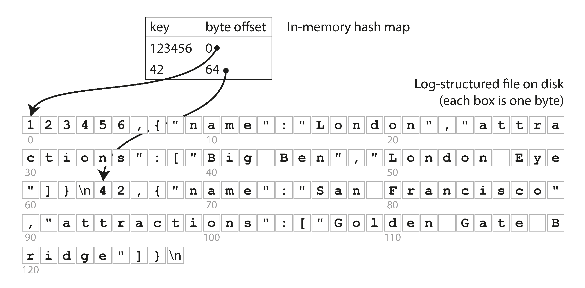

- 같은 key의 갱신을 계속 추가하면 오래된 값이 쌓임. compaction은 각 key의 최신 값만 남기는 과정임

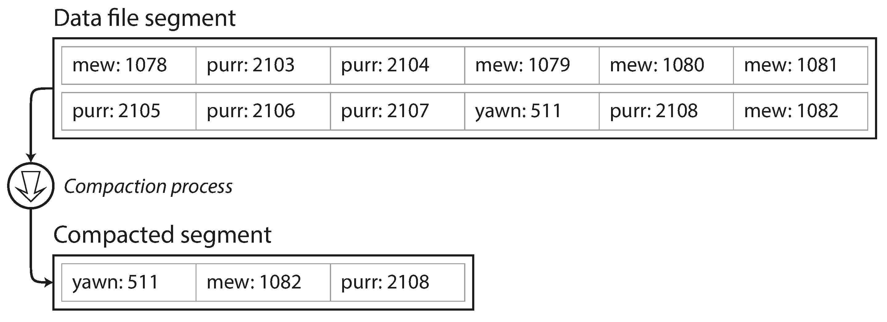

- 여러 segment를 merge하면서 compaction을 함께 수행할 수 있음. 기존 segment에서 최신 값을 골라 새 segment로 씀

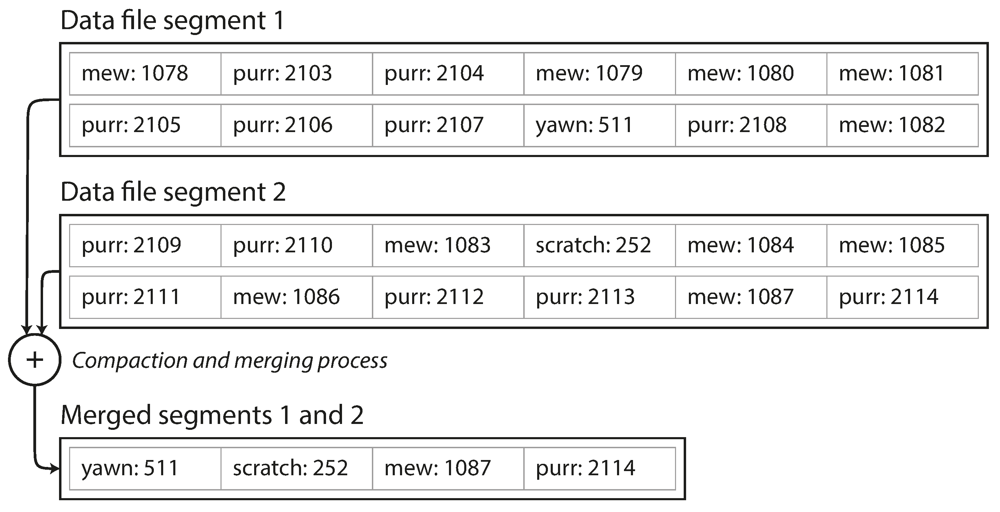

- append와 immutable segment는 순차 쓰기와 복구에 유리함
- 이 방식은 key index가 memory에 들어가야 하고 range query에 불리함
- 삭제는 tombstone으로 표시함. 병합 시 과거 값이 다시 나타나지 않도록 처리해야 함

##### SSTables and LSM-Trees — 정렬한 파일을 합치기

- SSTable은 key 순서로 정렬한 key-value segment임
- 정렬된 파일끼리는 순차적으로 merge할 수 있음. 같은 key가 겹치면 더 최신 값을 선택함

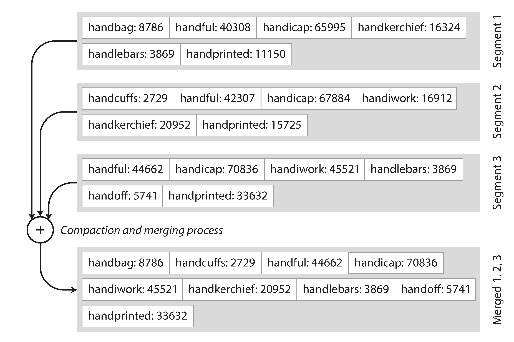

- 정렬 덕분에 모든 key의 위치를 memory에 둘 필요가 없음. sparse index로 근처를 찾고 짧게 scan할 수 있음
- 인접한 key를 묶어 압축하고 range scan하기에도 유리함

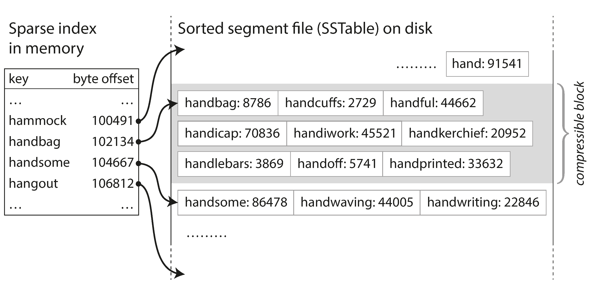

###### Constructing and Maintaining SSTables — 생성과 유지

1. 변경을 복구용 log에 기록하고 정렬된 memory 구조인 memtable에 반영함
2. memtable이 커지면 SSTable로 flush함
3. 읽을 때 memory와 최신 segment부터 확인함
4. background compaction으로 segment를 합치고 오래된 값을 제거함

- flush 전 crash가 나면 log에서 memtable을 복구함

###### Making an LSM-Tree out of SSTables — LSM 구조와 탐색 비용

- memory 갱신과 정렬된 segment 병합을 결합한 구조가 LSM-tree 계열임
- 없는 key를 찾을 때 여러 segment를 읽을 수 있음. Bloom filter는 해당 segment에 key가 없음을 빠르게 판정하는 데 사용됨
- Bloom filter는 false positive가 가능하므로 “있을 수 있음”만으로 실제 존재를 확정하지 않음
- size-tiered·leveled compaction은 병합 대상과 공간·쓰기 비용이 다름. 실제 정책과 설정은 저장 엔진 버전별 문서로 확인해야 함

##### B-Trees — page를 따라 내려가기

- B-tree는 고정 크기 page에 key와 하위 page 참조를 저장하는 균형 tree임
- root에서 key 범위에 맞는 child를 따라 leaf까지 내려감. 정확한 key와 범위 조회에 적합함

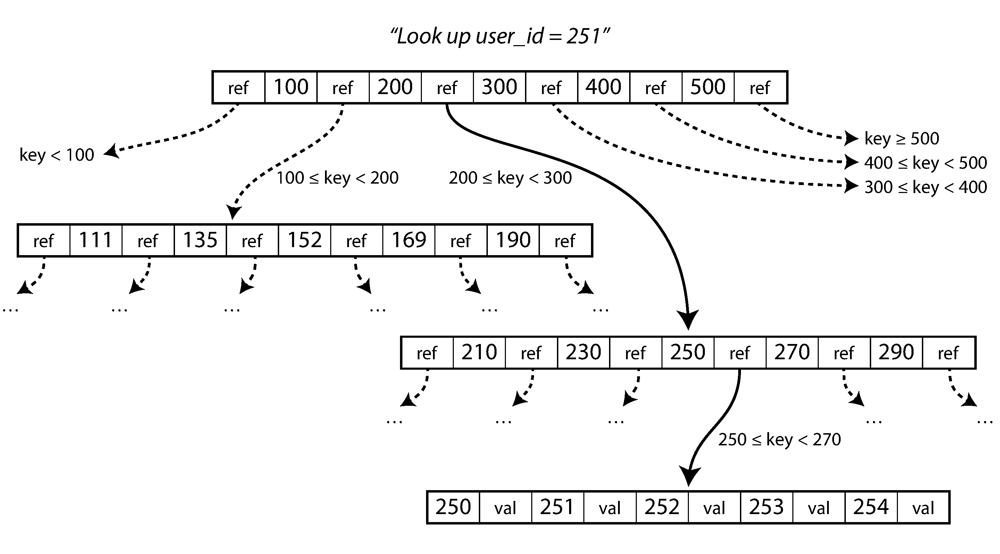

- 삽입할 page에 공간이 없으면 split하고 parent의 참조를 갱신함

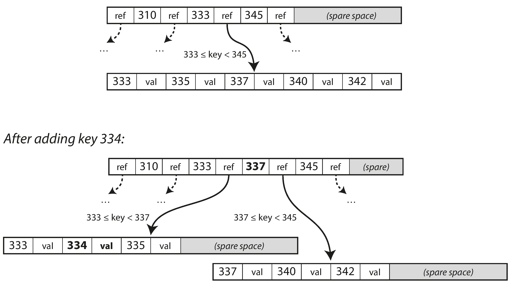

###### Making B-Trees Reliable — 중단 후 구조 복구

- 여러 page를 갱신하다 중단되면 구조가 불완전해질 수 있음. 일반적인 대응은 page 변경 전에 WAL을 기록하는 것임
- 동시 접근에는 latch 같은 내부 동기화가 필요함

###### B-Tree Optimizations — 공간과 탐색 비용 조정

- copy-on-write, key 축약, leaf 간 연결, 물리 배치 개선 등으로 복구·공간·범위 조회 비용을 조정할 수 있음

##### Comparing B-Trees and LSM-Trees — 비용 비교

| B-tree | LSM-tree |
| --- | --- |
| 변경: page를 제자리 갱신 | 변경: memory·log에 모은 뒤 병합 |
| 읽기: tree 경로 탐색 | 읽기: 여러 segment 확인 |
| 쓰기 비용: WAL·page 갱신 | 쓰기 비용: flush·compaction |
| 주의: page 분할·동시 접근 | 주의: 병합 지연·공간 부족 |

- LSM은 높은 쓰기 처리량, B-tree는 예측 가능한 읽기에 유리한 경우가 있음. 구현과 workload에 따라 달라짐
- 둘 다 실제 데이터보다 더 많이 쓰는 write amplification이 생김
- compaction이 입력을 따라가지 못하면 segment와 읽기 비용이 쌓임. benchmark에는 background 작업과 tail latency도 포함해야 함

##### Other Indexing Structures — 다른 탐색 요구

- secondary index는 primary key 외의 값으로 row를 찾음. 같은 값에 여러 row가 연결될 수 있음

###### Storing Values Within the Index — 값과 참조의 저장 위치

- heap file은 row를 별도 위치에 두고 index가 참조함. 중복을 줄이지만 추가 조회가 필요함
- clustered index는 row를 index 안에 저장하고, covering index는 query에 필요한 column을 포함함. 읽기를 줄이는 대신 공간·갱신 비용이 늘어남

###### Multi-Column Indexes — 여러 조건의 조합

- multi-column index는 정해진 column 순서에 영향을 받음
- 여러 차원의 범위 검색에는 R-tree 같은 별도 구조가 필요할 수 있음

###### Full-Text Search and Fuzzy Indexes — 단어와 유사한 값 찾기

- full-text·fuzzy search는 단어 분석, 유사 문자열, 편집 거리 등을 다룸. 정확한 key 검색과 요구가 다름

###### Keeping Everything in Memory — memory 저장과 영속성

- in-memory database도 log·snapshot·replication으로 영속성을 제공할 수 있음. memory 사용 자체가 durability를 뜻하지는 않음

 

#### Transaction Processing or Analytics? — 개별 업무와 전체 분석 구분

| 구분 | OLTP | OLAP |
| --- | --- | --- |
| 읽기 | 소수 record의 빠른 조회 | 다수 row의 scan·집계 |
| 쓰기 | 업무별 작은 갱신 | 대량 적재·이력 축적 |
| 정비 비유 | 특정 부품의 현재 장착 상태 확인 | 전체 기단의 결함 추세 분석 |

##### Data Warehousing — 운영과 분석 분리

- 무거운 분석 query가 운영 database를 방해하지 않도록 별도 warehouse를 구성함
- ETL은 원본에서 추출하고, 분석용 구조로 변환한 뒤 적재하는 과정임
- 같은 SQL을 쓰더라도 OLTP와 warehouse의 저장·실행 방식은 다를 수 있음

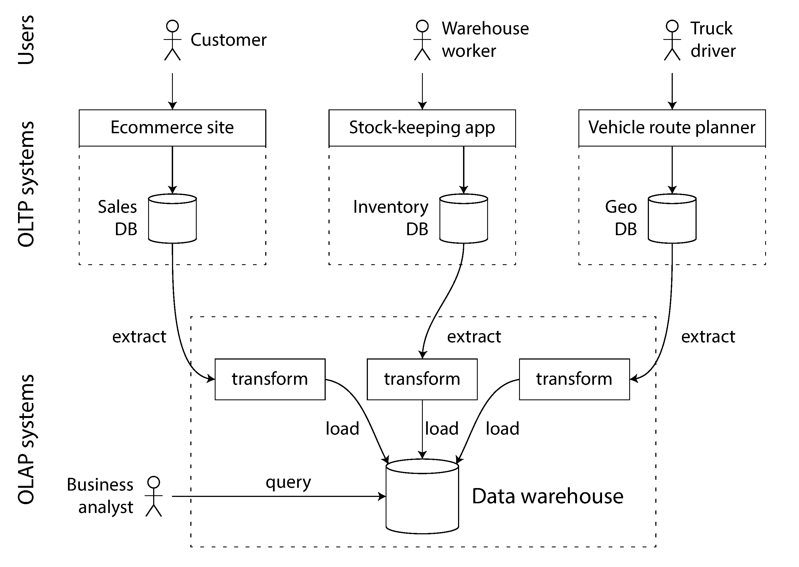

##### Stars and Snowflakes: Schemas for Analytics — 사실과 차원

- fact table은 발생한 event를 저장하고 dimension table은 대상·장소·시간 등의 설명을 제공함
- star schema는 fact 주위에 dimension을 배치함
- snowflake schema는 dimension을 다시 나눠 정규화함. 중복을 줄이지만 분석 시 연결이 늘어남

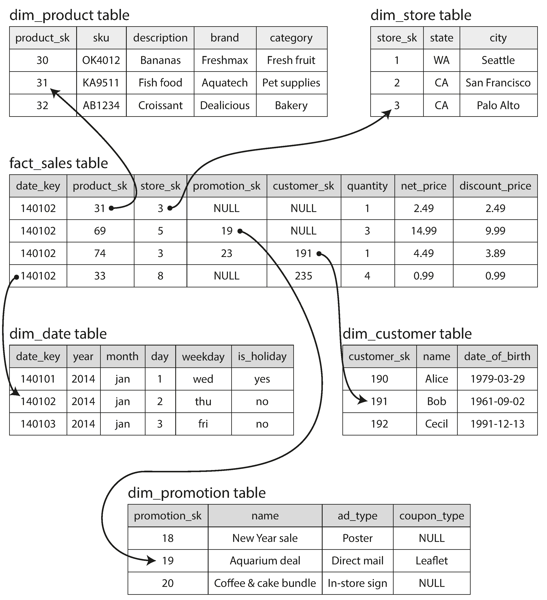

 

#### Column-Oriented Storage — 필요한 column만 읽기

- 분석은 많은 row 중 일부 column만 사용하는 경우가 많음
- column-oriented storage는 같은 column의 값을 모아 저장해 불필요한 I/O를 줄임
- 각 column은 동일한 row 순서를 유지해야 원래 record를 재구성할 수 있음
- column-family라는 데이터 모델 이름과 물리적인 column 저장을 혼동하지 않아야 함

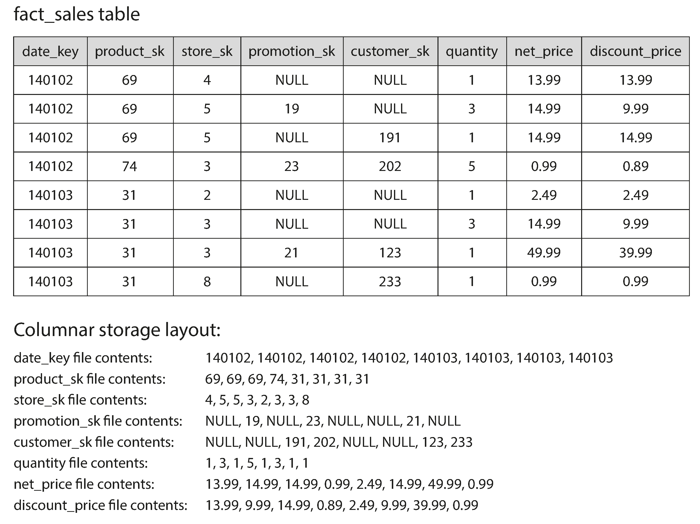

##### Column Compression — 반복 값 압축

- 같은 column은 type이 같고 값이 반복되기 쉬워 압축에 유리함
- bitmap은 특정 값이 있는 row를 bit로 표시함. AND·OR로 조건을 조합할 수 있음
- run-length encoding 등으로 연속된 bit를 압축할 수 있음
- 압축과 vectorized processing은 disk I/O뿐 아니라 CPU cache 활용에도 도움됨

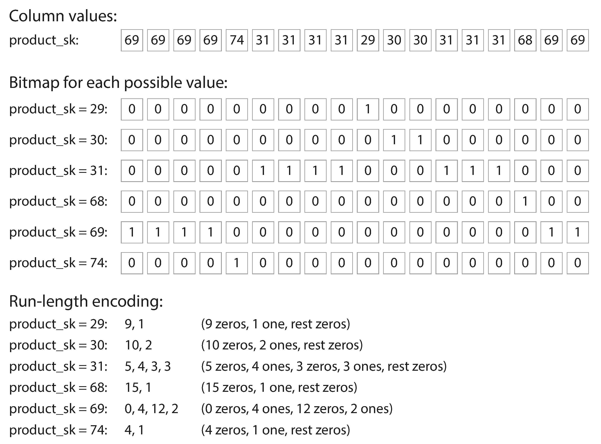

##### Sort Order in Column Storage — 정렬과 배치

- 자주 쓰는 조건에 맞춰 row 전체의 정렬 순서를 정하면 scan 범위와 압축률을 개선할 수 있음
- column마다 독립적으로 정렬하면 row 대응 관계가 깨짐
- 여러 replica를 서로 다른 순서로 저장해 query별로 적합한 배치를 활용할 수도 있음

##### Writing to Column-Oriented Storage — 변경을 모아 반영

- 압축·정렬된 column 중간의 갱신은 비용이 큼
- memory에 변경을 모은 뒤 column file에 일괄 병합하는 접근이 가능함
- query는 아직 병합되지 않은 변경과 기존 file을 함께 반영해야 함

##### Aggregation: Data Cubes and Materialized Views — 미리 계산한 결과

- materialized view는 query 결과를 실제로 저장한 파생 데이터임. 원본 변경 시 유지 비용이 생김
- data cube는 여러 dimension의 집계를 미리 계산한 구조임
- 빠르게 답할 수 있는 query가 정해짐. 미리 집계하지 않은 세부 조건은 원본 데이터가 필요함

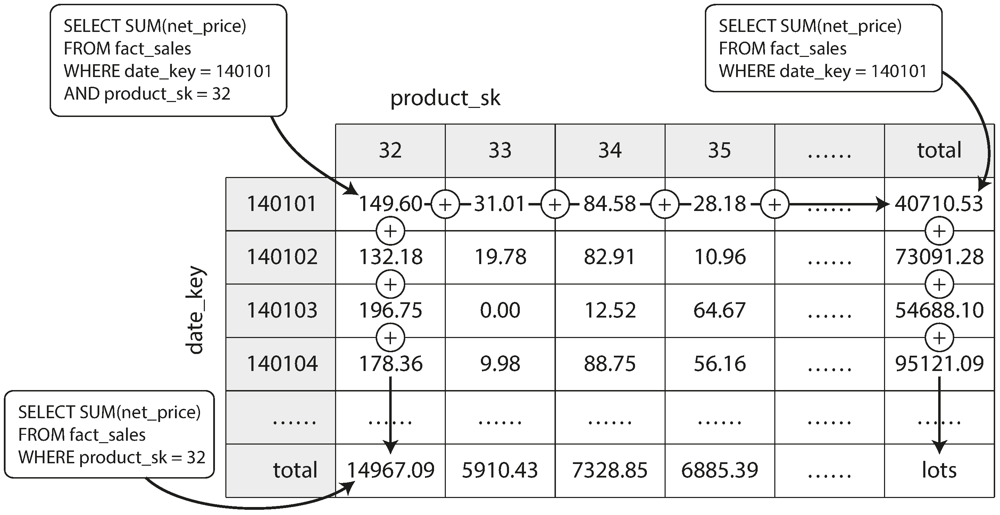

 

#### Summary — 정리

- index는 읽기를 빠르게 하지만 쓰기·공간·복구 비용을 늘림
- OLTP는 작은 데이터의 신속한 접근, OLAP는 대량 데이터의 효율적인 scan에 초점을 둠
- 구조의 이름보다 실제 접근 패턴과 background 작업을 포함한 비용을 비교해야 함
