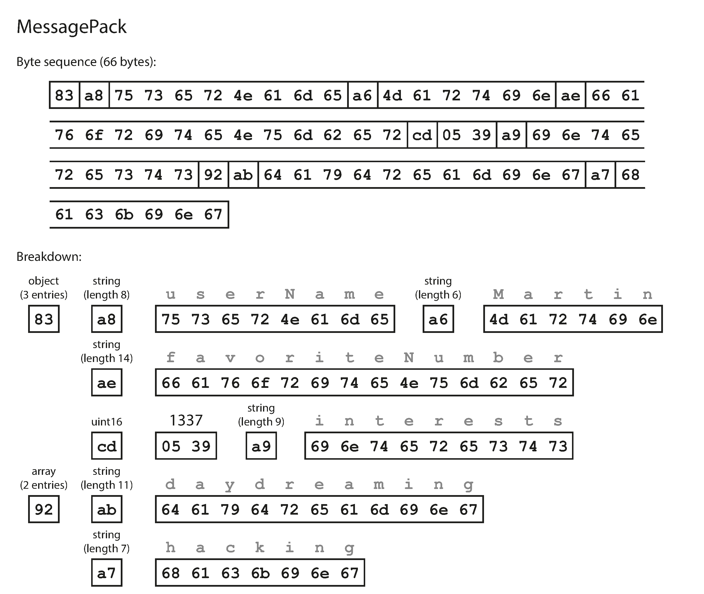
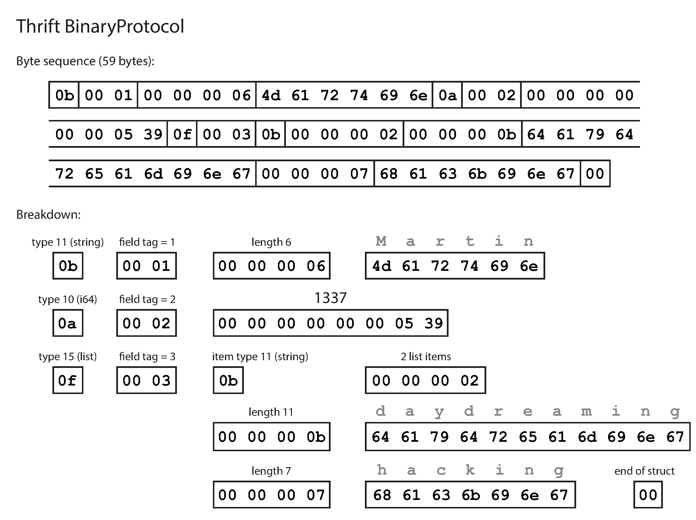
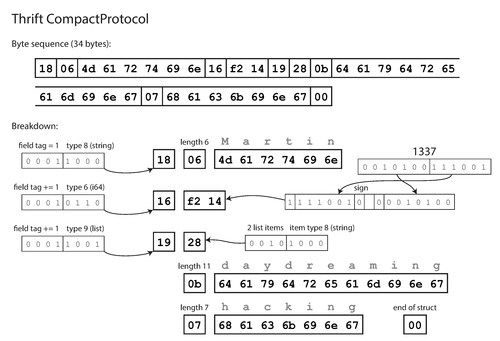
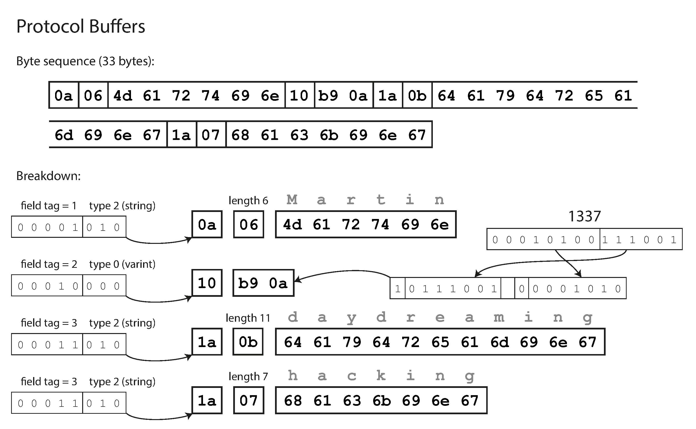
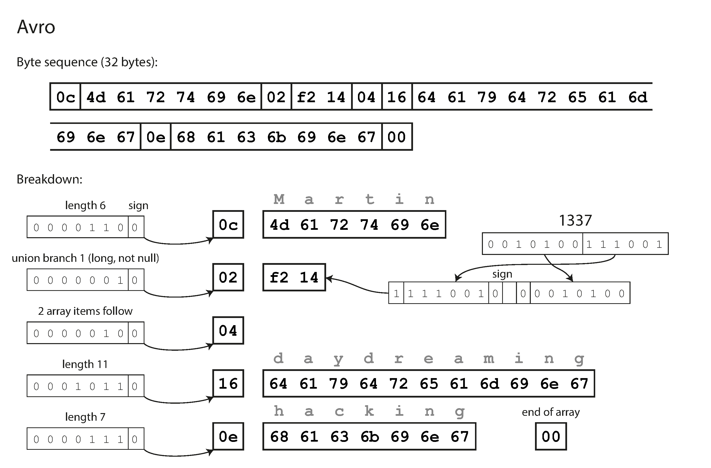
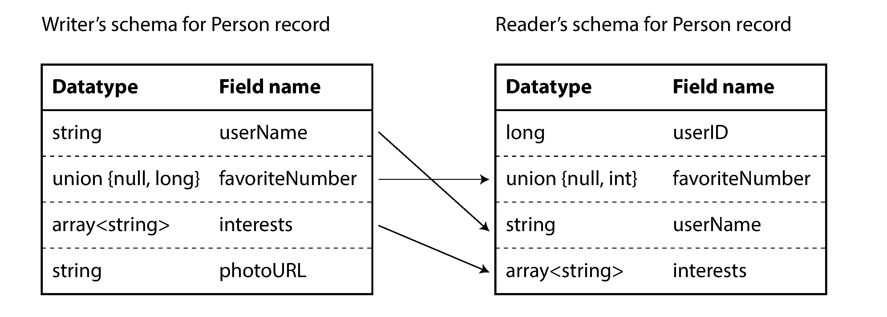
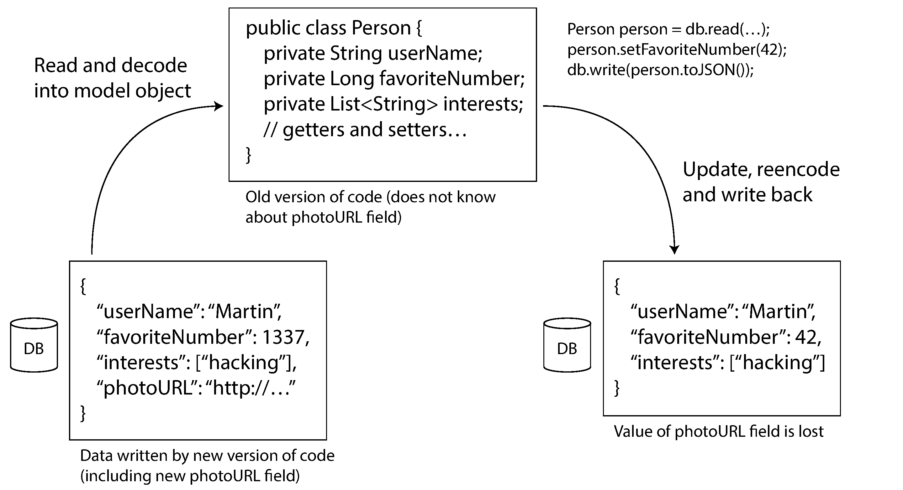

## Designing Data-Intensive Applications

### 4장. Encoding and Evolution

- 원문: 초판, 본문 pp. 111–140 / PDF pp. 133–162. 참고문헌은 PDF p. 162부터 시작함
- 핵심: 구버전과 신버전이 함께 동작하도록 데이터 형식의 변경 규칙을 정함
- 정비 관점: 양식이 개정돼도 과거 기록을 읽을 수 있어야 하고, 구형 입력 시스템이 새 항목을 지우지 않아야 하는 문제와 유사함

| 호환성 | 읽는 쪽 | 읽어야 하는 데이터 |
| --- | --- | --- |
| backward compatibility | 신버전 | 구버전이 쓴 데이터 |
| forward compatibility | 구버전 | 신버전이 쓴 데이터 |

- rolling upgrade와 늦게 갱신되는 client 때문에 두 방향의 호환성이 필요함

 

#### Formats for Encoding Data — 메모리 구조를 byte로 바꾸기

- encoding은 객체·구조체 등을 저장·전송 가능한 byte sequence로 바꾸는 과정임. decoding은 그 반대임
- 메모리의 pointer나 객체 배치를 그대로 다른 process가 해석할 수는 없음
- 형식의 선택은 크기·속도뿐 아니라 장기 보관과 버전 공존에도 영향을 줌

##### Language-Specific Formats — 언어에 종속된 형식

- 언어의 내장 객체 저장 기능은 편리하지만 다른 언어·클래스 버전과의 연동에 제약이 있음
- 임의 객체를 복원하는 기능은 보안 위험도 만들 수 있음
- [Python 공식 문서](https://docs.python.org/3/library/pickle.html)는 신뢰할 수 없는 pickle을 역직렬화하면 임의 코드가 실행될 수 있다고 명시함
- 호환성은 언어·protocol·클래스 정의에 따라 다름. 모든 내장 형식이 과거 데이터를 읽지 못한다고 일반화하지 않음

##### JSON, XML, and Binary Variants — 범용 형식과 표현 한계

- JSON·XML·CSV는 널리 지원되지만 type과 구조의 해석을 별도로 합의해야 함
- JSON의 큰 정수는 읽는 환경의 수 표현 범위에 따라 정밀도를 잃을 수 있음
- JSON·XML의 binary data는 Base64 같은 표현을 쓰면 크기가 증가함. CSV는 type·column 의미·escape 규칙을 주의해야 함

###### Binary Encoding — 이름을 함께 저장하는 비용

- binary variant는 크기를 줄일 수 있지만, field 이름을 매번 담으면 절감 폭이 제한됨

##### Thrift and Protocol Buffers — field 번호를 계약으로 사용

- schema에 field의 type과 번호를 정의하고, 데이터에는 이름 대신 번호를 기록함
- 구버전 reader가 모르는 field를 건너뛸 수 있도록 type·길이 정보가 사용됨

- **Thrift BinaryProtocol:** field 이름 대신 번호를 저장함. 그림에서는 각 field의 type·번호와 값이 어떻게 나뉘는지 확인함

- **Thrift CompactProtocol:** 같은 정보를 더 조밀하게 표현함. type·field 번호를 묶고 가변 길이 정수를 사용해 작은 정수가 차지하는 공간을 줄임

- **Protocol Buffers:** field 번호와 type 정보를 사용하지만 bit 배치가 CompactProtocol과 다름. 세 그림은 책의 같은 record를 비교한 예시임

###### Field Tags and Schema Evolution — 번호의 의미 유지

- field 번호를 바꾸거나 삭제한 번호를 다른 의미로 재사용하면 과거 데이터를 잘못 해석할 수 있음
- 새 필수 field를 추가하면 과거 record에 값이 없어 호환성이 깨질 수 있음
- 책의 `required` 설명은 당시 schema 문법의 맥락임. [Protocol Buffers proto3 공식 문서](https://protobuf.dev/programming-guides/proto3/)의 field presence·변경 규칙을 따로 확인해야 함. 삭제한 번호는 `reserved`로 남기는 규칙을 제공함

###### Datatypes and Schema Evolution — 값의 범위 보존

- 정수의 크기·type을 바꿀 때는 decoding 성공 여부와 값의 보존 여부를 함께 검토함

##### Avro — 쓴 schema와 읽는 schema 대조

- Avro binary record는 field 번호나 이름을 반복하지 않음. reader가 writer schema를 알아야 함
- 그림 4-5는 field 번호 없이 schema 순서에 따라 값을 저장하는 방식을 보여줌

###### The Writer’s Schema and the Reader’s Schema — 두 구조의 차이 해결

- writer schema는 저장 당시 구조, reader schema는 현재 코드가 기대하는 구조임
- field 순서는 달라도 이름으로 대응시킬 수 있음
- writer에만 있는 field는 건너뛰고, reader에만 있는 field는 reader의 default가 있어야 읽을 수 있음

###### Schema Evolution Rules — 누락 field의 처리 조건

- default가 있다는 사실이 field를 encoding에서 생략한다는 뜻은 아님
- field 추가·삭제, type 승격, union 해석은 [Avro 1.12.0 specification의 Schema Resolution](https://avro.apache.org/docs/1.12.0/specification/#schema-resolution) 규칙에 따라 확인함

###### But What Is the Writer’s Schema? — 저장 당시 구조 전달

- file header, record의 schema ID, 연결 시 협상 등으로 writer schema를 전달할 수 있음
- 동적으로 schema를 만들기 쉬우며, code generation은 사용 언어와 도구에 따라 선택함

##### The Merits of Schemas — 변경을 관리하는 명시적 규칙

- schema는 데이터 형식의 문서이자 호환성 검사 기준임
- 반복되는 field 이름을 줄이고, 정적 type 언어에서는 코드 생성·type 검사에 활용할 수 있음
- schema가 있다는 이유만으로 변경이 어려운 것은 아님. 과거 형식과의 관계를 명시하면 변경을 검토하기 쉬워짐

 

#### Modes of Dataflow — 데이터가 만나는 경계

- database는 시간 차이를 두고, service는 request·response로, message는 비동기 전달로 writer와 reader를 연결함
- 각 경계에서 서로 다른 버전이 만날 수 있음

##### Dataflow Through Databases — 저장 후 다시 읽고 쓰기

- 새 코드가 기록한 field를 구버전 코드가 읽고 다시 저장할 때 잃어버릴 수 있음
- “구버전에서 읽을 수 있음”과 “읽고 수정한 뒤 새 field까지 보존함”은 별도 검증 대상임
- backup·archive에도 당시 schema가 필요함. 오래된 기록과 schema history를 함께 관리해야 함

##### Dataflow Through Services: REST and RPC — 독립 배포되는 호출자와 서버

- service는 API를 통해 데이터를 주고받음. client와 server의 배포 시점이 다를 수 있음
- REST는 resource와 HTTP의 원칙을 활용하는 설계 방식, RPC는 원격의 작업을 호출하는 방식임
- 원격 호출은 local function call과 달리 지연·timeout·부분 실패가 있음. 응답이 없다고 실행되지 않았다고 판단할 수 없음
- retry하면 같은 효과가 두 번 생길 수 있으므로 작업 식별과 중복 처리를 고려해야 함
- 호환성에는 데이터 형식뿐 아니라 API 동작과 오류 의미도 포함됨

##### Message-Passing Dataflow — 나중에 처리하는 전달

- broker는 sender와 receiver의 실행 시점을 분리하고, 일시 중단·부하 증가 시 message를 보관할 수 있음
- queue가 무한한 처리 능력을 만들지는 않음. 적체·보관 한도·생산자 속도 제어를 함께 설계해야 함
- sender가 구버전이고 receiver가 신버전이거나 그 반대일 수 있음. 오래 보관된 message도 고려해야 함
- actor 간 통신도 서로 다른 버전의 message를 해석하는 문제가 있음. 책의 framework별 기본 encoding은 당시 사례로 보고 해당 버전의 공식 문서를 확인해야 함

 

#### Summary — 정리

- encoding은 byte 변환과 함께 버전 간 계약을 정하는 작업임
- 번호·type·default·unknown field 보존 규칙이 호환성을 좌우함
- database·API·message의 모든 경로에서 구버전·신버전과 과거 데이터가 공존하는 상황을 검토해야 함
