## Designing Data-Intensive Applications

### 5장. Replication

- 원문: 초판, 본문 pp. 151–193 / PDF pp. 173–215. 참고문헌은 PDF p. 215부터 시작함
- 핵심: 같은 데이터를 여러 장비에 유지하면 장애·거리·읽기 부하에 대응할 수 있지만, 변경 순서와 지연을 다뤄야 함
- 정비 관점: 여러 기지에 정비 기록 사본을 둘 때, 수정 권한과 전달 지연·상충 기록 처리 규칙을 정하는 문제와 유사함
- 이 장은 데이터 복사를 다룸. 데이터 자체를 나누는 partitioning은 6장에서 다룸

 

#### Leaders and Followers — 한곳에서 변경 순서 결정

- single-leader 방식은 leader가 쓰기를 받고, follower는 변경 log를 순서대로 적용함
- 읽기는 여러 replica로 나눌 수 있지만 쓰기는 leader를 통과함
- 한 기록의 정식 수정 창구를 하나로 두는 구조임. 충돌 처리는 단순해지지만 leader 장애에 대비해야 함

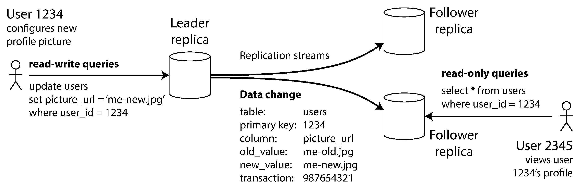

##### Synchronous Versus Asynchronous Replication — 언제 성공을 응답할지 결정

| 방식 | 성공 응답 시점 | 비용·위험 |
| --- | --- | --- |
| synchronous | 지정 follower의 확인 후 | follower 지연·장애가 쓰기를 막을 수 있음 |
| asynchronous | follower 확인을 기다리지 않음 | leader 손실 시 미복제 변경을 잃을 수 있음 |

- 모든 follower를 동기로 묶으면 하나의 장애에도 쓰기가 멈출 수 있음. 일부만 동기로 두는 구성도 가능함
- “복제됨”이 memory 수신인지 disk 반영인지 등은 제품의 확인 조건에 따라 달라짐

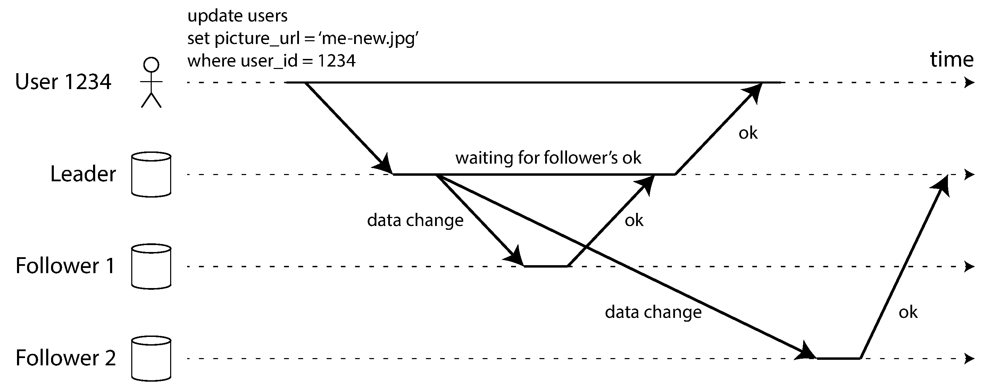

##### Setting Up New Followers — snapshot 이후 변경 따라잡기

1. 일관된 snapshot과 그 시점의 log position을 확보함
2. snapshot을 새 follower에 복사함
3. 해당 position 이후의 log를 적용함
4. 누적 변경을 따라잡은 뒤 정상 복제에 참여함

- 운영 중인 file을 순서 없이 복사하면 서로 다른 시점의 데이터가 섞일 수 있음

##### Handling Node Outages — 복귀와 leader 교체

- follower는 마지막 적용 position부터 log를 받아 복귀할 수 있음. 필요한 log가 남아 있어야 함
- leader 장애는 감지 → 새 leader 선정 → client 경로 변경 → 이전 leader 정리라는 failover가 필요함
- 비동기 복제에서는 새 leader에 최근 변경이 없을 수 있음. 이미 성공 응답한 기록이 사라질 가능성도 있음
- 두 node가 동시에 leader라고 판단하는 split brain과, 짧은 timeout에 의한 불필요한 교체를 주의해야 함

##### Implementation of Replication Logs — 무엇을 전달할지 결정

| 방식 | 전달 내용 | 주의점 |
| --- | --- | --- |
| statement-based | 실행한 쓰기 statement | 현재 시간·난수·trigger 등으로 결과가 달라질 수 있음 |
| WAL shipping | 저장 엔진의 물리적 변경 log | 내부 저장 형식과 버전에 강하게 연결됨 |
| logical log | row 단위의 추가·삭제·변경 | 외부 시스템 연동과 버전 차이 대응에 유리함 |
| trigger-based | trigger가 남긴 변경 | 유연하지만 부하와 구현 오류가 늘 수 있음 |

- 책의 제품별 복제 설정은 당시 사례임. 실제 rolling upgrade와 복제 확인 조건은 해당 버전 공식 문서로 확인해야 함

 

#### Problems with Replication Lag — 사본이 뒤처질 때 보이는 문제

- 비동기 follower는 leader의 변경을 늦게 적용할 수 있음
- eventual consistency는 새 쓰기가 없고 변경이 전파되면 결국 수렴한다는 뜻임. 지연 시간의 상한을 약속하지는 않음
- 사본으로 업무를 처리하려면 어떤 순서와 최신성이 필요한지 먼저 정해야 함

##### Reading Your Own Writes — 내가 쓴 기록 다시 보기

- read-your-writes는 사용자가 자신의 완료된 변경보다 과거 상태를 읽지 않도록 하는 보장임
- 수정 직후 leader에서 읽거나, 자신의 마지막 write position 이상 반영한 replica를 선택할 수 있음
- 여러 기기를 쓰면 마지막 write 정보를 기기 간에도 공유해야 할 수 있음
- 고정 대기 시간만으로 임의의 복제 지연을 확실히 해결할 수는 없음

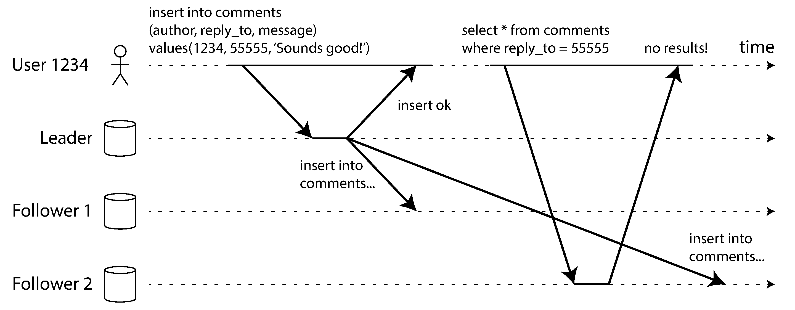

##### Monotonic Reads — 읽은 상태가 과거로 돌아가지 않기

- 새 기록을 읽은 뒤 더 오래된 사본으로 이동해 과거 상태를 보는 일을 막음
- 같은 사용자에게 일정한 replica를 배정하는 방법이 있음. 장애 시 다른 replica로 바뀌는 경로도 고려해야 함
- 항상 최신 상태를 본다는 보장과는 다름

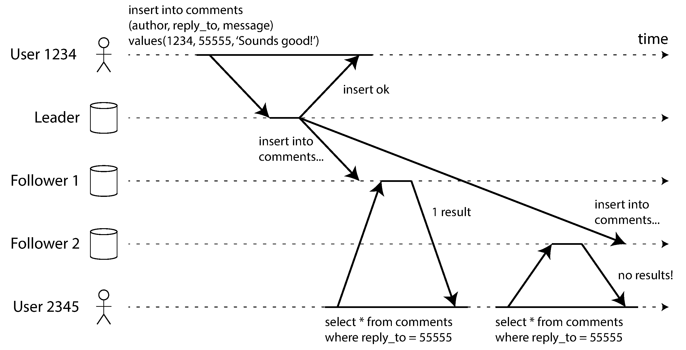

##### Consistent Prefix Reads — 원인보다 결과를 먼저 보지 않기

- 쓰기 순서의 중간을 건너뛰지 않도록 함. 질문보다 답변이 먼저 보이는 것이 대표적인 위반 사례임
- 관련 기록이 여러 partition에 나뉘고 복제 속도가 다르면 발생하기 쉬움
- 정비 기록에 빗대면 작업 요청이 아직 보이지 않는데 완료 기록만 먼저 보이는 상황임

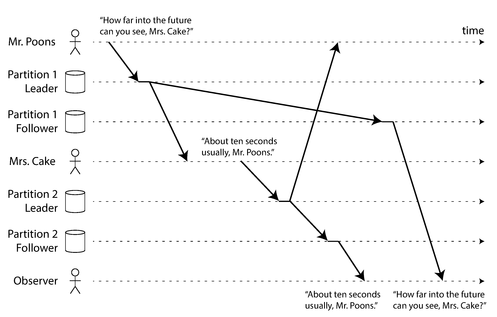

##### Solutions for Replication Lag — 필요한 보장을 명시

- lag가 커져도 허용할 기능과 더 강한 보장이 필요한 기능을 구분함
- 애플리케이션의 replica 선택·position 추적은 복잡함. database가 제공하는 보장의 범위를 먼저 확인해야 함
- transaction이 일부 복잡도를 줄일 수 있지만, 모든 복제 지연 문제를 자동으로 해결하는 것은 아님

 

#### Multi-Leader Replication — 여러 곳에서 변경 허용

- 여러 leader가 각각 쓰기를 처리한 뒤 서로에게 변경을 전달함
- 기지별로 네트워크 단절 중에도 기록을 수정하고, 연결 복구 후 합치는 구조와 유사함

##### Use Cases for Multi-Leader Replication — 사용 상황

- 여러 datacenter의 local write, offline client, 공동 편집 등에 활용할 수 있음
- 지역 간 지연·단절에 대응하는 대신 동시에 바뀐 데이터의 충돌 해결이 필요함

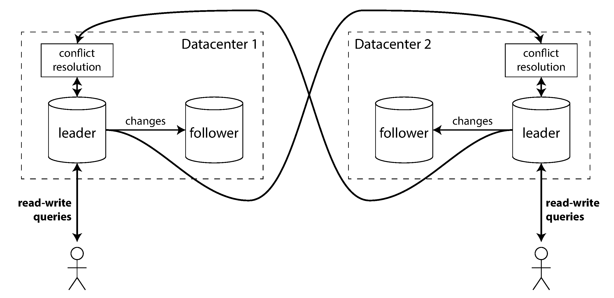

##### Handling Write Conflicts — 상충하는 수정 처리

- 두 leader에서 같은 field를 바꾸면 각각 성공한 뒤 나중에 충돌을 발견할 수 있음
- 특정 record의 쓰기를 한 leader로 모아 충돌을 피하거나, 병합 규칙을 정의해야 함

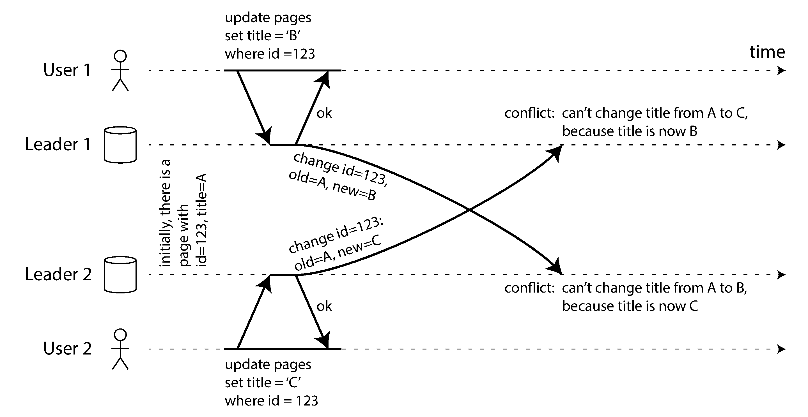

- last write wins는 timestamp 등으로 승자를 고름. 모든 변경을 보존하는 방식은 아니며 clock 오차에도 영향을 받음
- 값의 병합, 충돌 record 보관, 사용자 확인 등은 데이터의 의미에 따라 선택함
- 정비 이력처럼 변경을 임의로 버리기 어려운 기록에 단순한 승자 선택을 적용하면 정보가 유실될 수 있음

##### Multi-Leader Replication Topologies — 전달 경로와 순서

- circular·star·all-to-all topology는 장애 전파와 중복 전달·순서 처리 비용이 다름
- 중간 node에 의존하는 경로는 해당 node의 장애로 전달이 끊길 수 있음

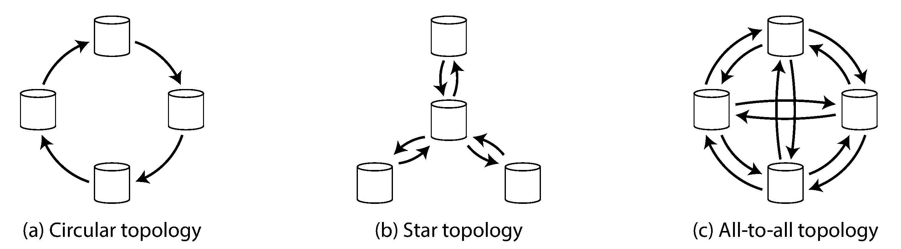

- 여러 경로를 쓰면 update가 insert보다 먼저 도착할 수 있음. 인과 의존성을 추적해야 함

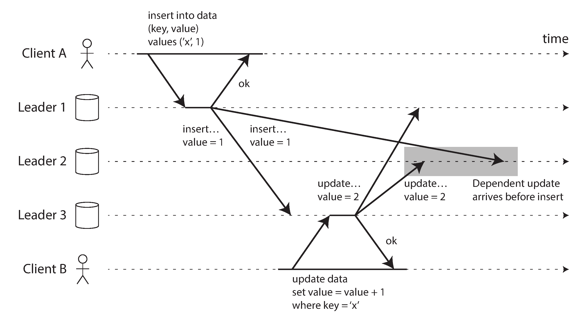

 

#### Leaderless Replication — 여러 replica에 직접 요청

- 쓰기 순서를 정하는 단일 leader 없이 여러 replica에 읽기·쓰기를 요청함
- coordinator가 요청을 모아도 그것만으로 leader의 순서 보장을 제공하지는 않음

##### Writing to the Database When a Node Is Down — 일부 node 장애 중 처리

- 일부 replica가 응답하지 않아도 필요한 수의 응답을 받으면 진행할 수 있음
- read repair는 조회 중 발견한 오래된 값을 고치고, anti-entropy는 background에서 replica 차이를 맞춤
- 거의 읽히지 않는 값은 read repair만으로 수렴을 보장하기 어려움

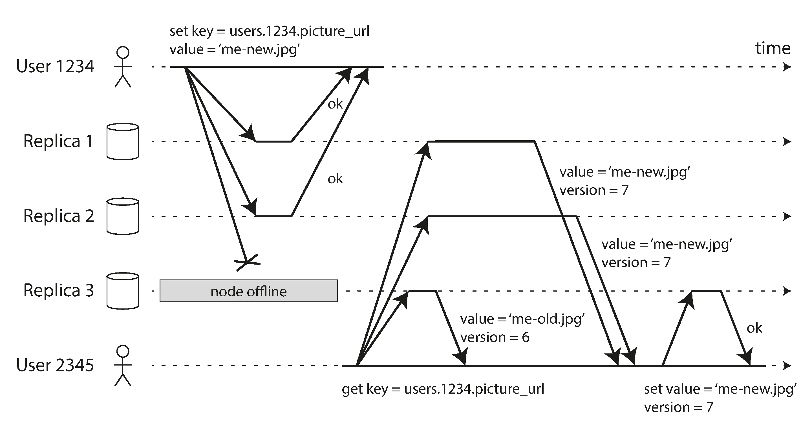

- `n`은 해당 key의 replica 수, `w`는 쓰기 성공에 필요한 확인 수, `r`은 읽기에 필요한 응답 수임
- 고정된 replica 집합에서 `w + r > n`이면 읽기·쓰기 집합이 적어도 하나 겹침
- 예: `n=3, w=2, r=2`이면 한 replica가 응답하지 않아도 읽기·쓰기가 가능함

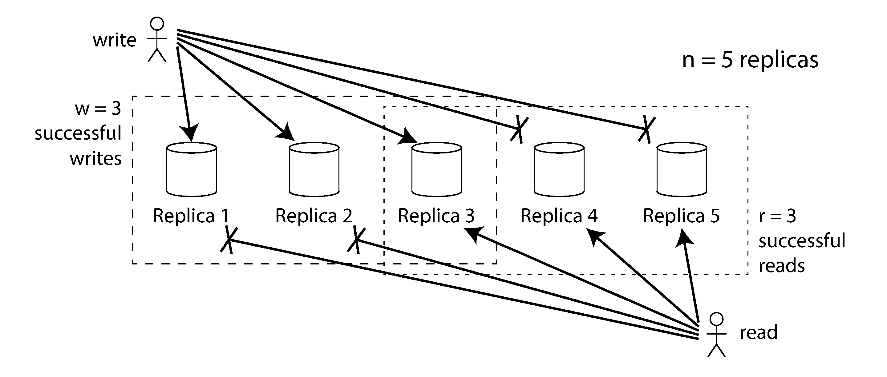

##### Limitations of Quorum Consistency — 겹친다는 조건의 한계

- quorum 교집합만으로 선형성이나 모든 읽기의 최신성이 보장되지는 않음
- 동시 쓰기, 일부만 적용된 실패한 쓰기, 복구 중 값 손실, 읽기와 쓰기의 겹침을 별도로 고려해야 함
- 응답 수와 함께 version 비교·복구·충돌 해석 규칙이 필요함

##### Sloppy Quorums and Hinted Handoff — 임시 대리 저장

- home replica에 접근할 수 없으면 다른 node가 임시로 쓰기를 받아 availability를 높일 수 있음
- hinted handoff는 이후 원래 replica에 변경을 돌려주는 과정임
- 읽기와 쓰기가 서로 다른 node 집합에서 처리될 수 있어 `w + r > n`만으로 교집합을 보장하지 못함

##### Detecting Concurrent Writes — 덮어쓰기와 동시 수정 구별

- replica별 도착 순서만으로 최종 값을 정하면 결과가 달라질 수 있음
- B가 A의 결과를 보고 수정했다면 A happens-before B임. 서로의 결과를 보지 못했다면 concurrent로 취급함
- 여기서 concurrent는 물리 시계상 같은 순간이라는 뜻이 아님

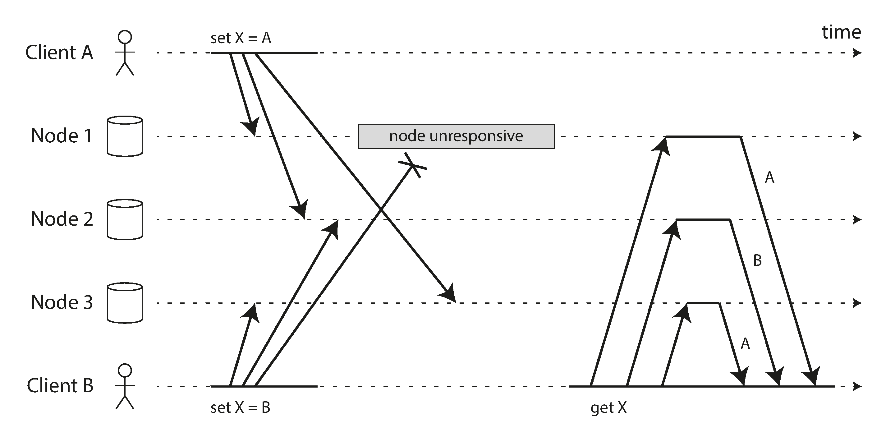

- version 정보는 어떤 과거 상태를 바탕으로 수정했는지 나타냄
- 인과적으로 뒤따른 변경은 과거 값을 대체할 수 있지만, 동시 변경은 sibling으로 남겨 병합해야 할 수 있음
- 추가만 있는 집합은 합집합으로 처리할 수 있음. 삭제는 tombstone 등 별도 의미가 필요함

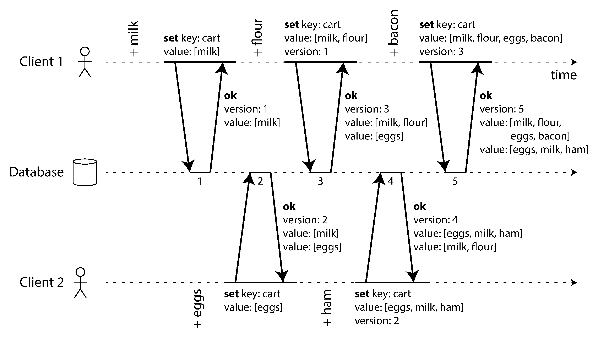

- 그림 5-14는 같은 이력을 인과 의존 graph로 표현함. 화살표 방향으로 이어지는 변경은 앞선 변경에 의존함

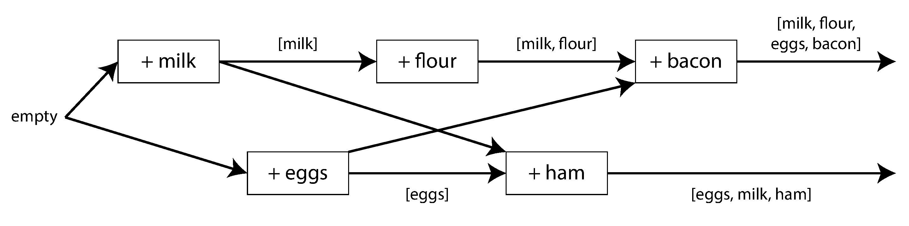

- 여러 replica에서는 replica별 version을 모은 version vector 등으로 의존성을 나타낼 수 있음
- 충돌 감지는 병합 규칙을 대신하지 않음. 무엇을 보존할지는 애플리케이션이 결정함

 

#### Summary — 정리

- single-leader는 쓰기 순서 관리가 단순하고, multi-leader·leaderless는 분산된 쓰기 대신 충돌 처리가 복잡함
- 복제본의 존재, 최신성, 장애 시 보존되는 데이터 범위는 서로 다른 조건임
- 읽기 보장과 데이터 유실 허용 범위를 먼저 정한 뒤 복제 방식을 선택해야 함
