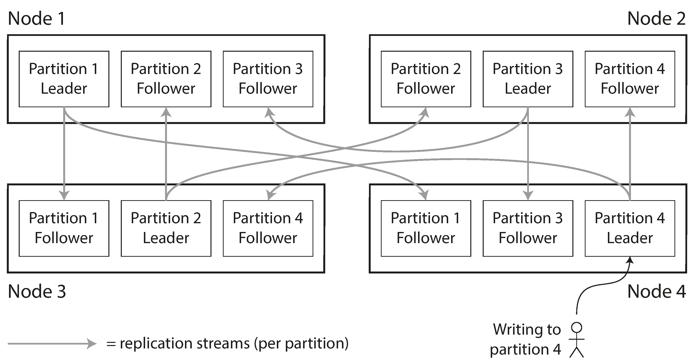
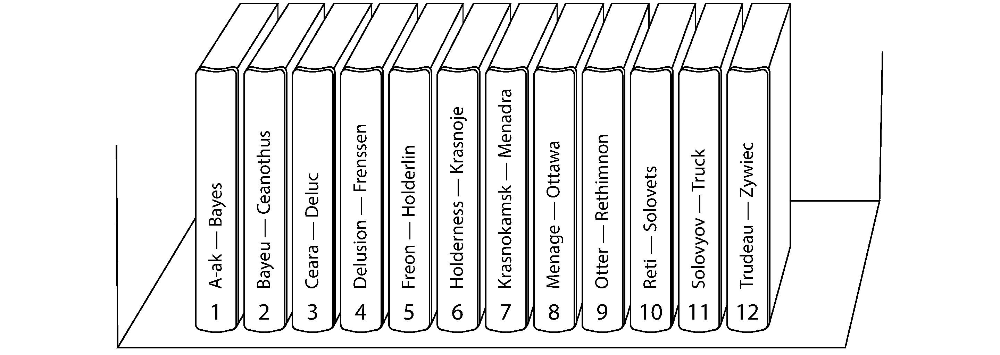
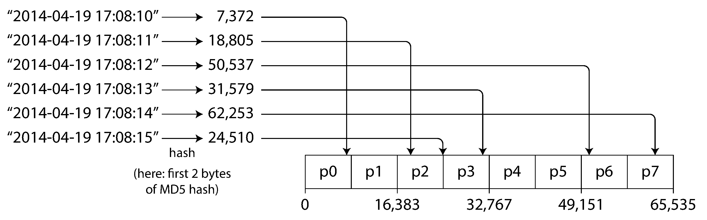
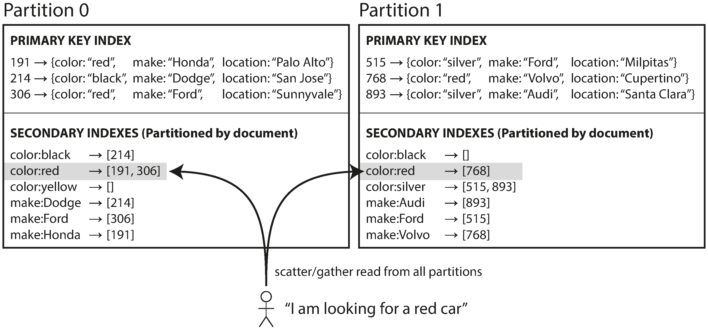
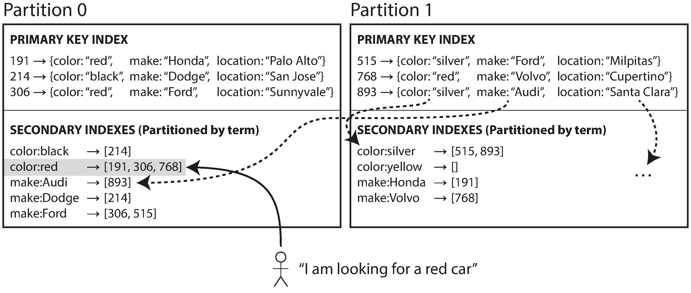
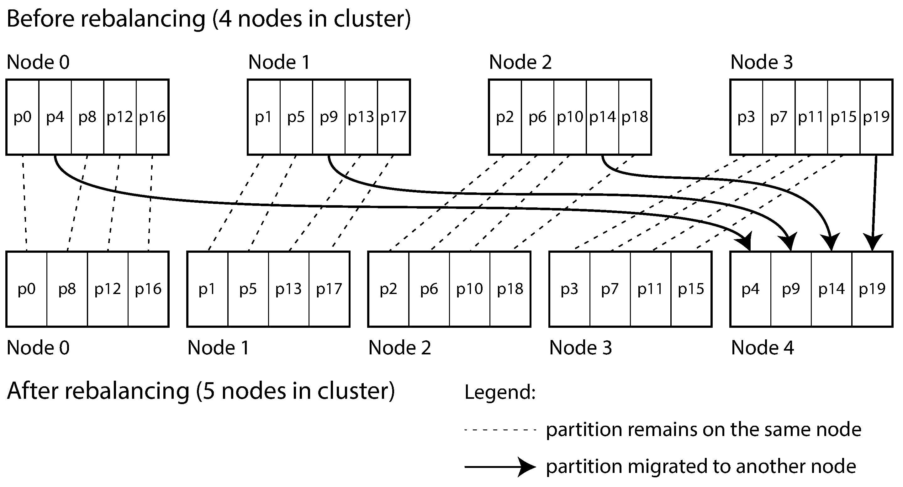
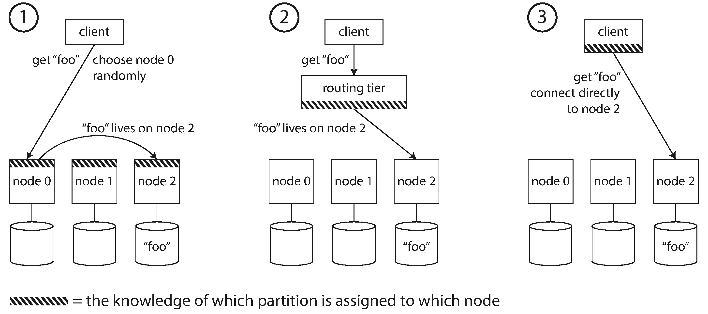
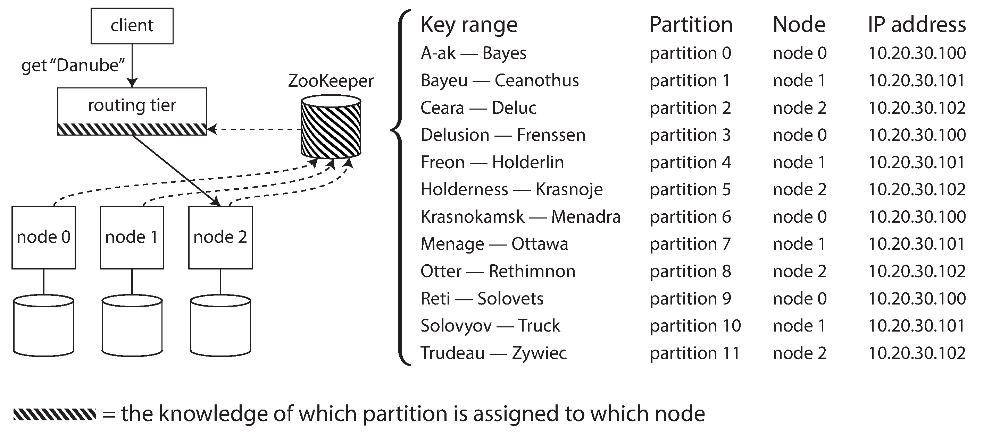

## Designing Data-Intensive Applications

### 6장. Partitioning

- 원문: 초판, 본문 pp. 199–218 / PDF pp. 221–240. 참고문헌은 PDF p. 240부터 시작함
- 핵심: 데이터와 요청을 나누고, 배치가 바뀌어도 올바른 곳으로 요청을 보냄
- 정비 관점: 방대한 기록을 기체·부품 번호 등으로 나눠 보관하되, 특정 창구에만 일이 몰리지 않게 하는 문제와 유사함

 

#### Partitioning and Replication — 분할과 복제의 역할

- partitioning은 데이터 집합을 나눠 저장량·처리량을 분산함
- replication은 각 partition의 사본을 만들어 장애에 대비함
- 한 record는 논리적으로 한 partition에 속하되 그 partition의 replica는 여러 node에 존재할 수 있음
- 한 node가 어떤 partition의 leader이며 다른 partition의 follower일 수도 있음

 

#### Partitioning of Key-Value Data — key로 담당 위치 결정

- 목표는 데이터 크기뿐 아니라 실제 요청 부하도 고르게 나누는 것임
- 일부 partition에 부하가 몰리는 skew와 hot spot이 생기면 node를 늘려도 효과가 제한됨
- 무작위 보관만 하면 조회 시 모든 node를 찾아야 함. key에서 담당 partition을 결정할 수 있어야 함

##### Partitioning by Key Range — 연속된 범위로 나누기

- key의 연속 구간을 partition별로 배정함. 정렬된 목록을 여러 권으로 나누는 방식임
- 범위 조회에 유리하지만 데이터·접근 분포에 맞춰 경계를 정해야 함

- timestamp를 맨 앞에 두면 현재 시간 구간에 쓰기가 집중될 수 있음
- sensor ID 뒤에 timestamp를 두면 sensor별로 분산할 수 있지만 전체 sensor의 시간 조회는 여러 범위를 읽어야 함

##### Partitioning by Hash of Key — hash로 분산

- key의 hash를 기준으로 partition을 정하면 비슷한 key도 넓게 분산할 수 있음
- node마다 같은 hash 규칙을 사용해야 함. process별 결과가 달라지는 함수는 그대로 쓰기 어려움
- 원래 key의 순서를 잃으므로 key 범위 조회는 여러 partition을 읽어야 할 수 있음

- compound key의 일부로 partition을 정하고 나머지로 내부 정렬을 하면, 분산과 특정 대상의 범위 조회를 절충할 수 있음

##### Skewed Workloads and Relieving Hot Spots — 인기 key 분산

- 같은 key에 요청이 몰리면 hash도 같은 결과를 내므로 hot spot이 남음
- hot key에 suffix 등을 붙여 여러 key로 나눌 수 있음. 대신 읽을 때 여러 결과를 합쳐야 함
- 모든 key에 적용하면 불필요한 비용이 생김. 실제 부하와 접근 패턴을 파악해야 함

 

#### Partitioning and Secondary Indexes — 다른 조건으로 찾기

- primary key 외의 조건은 원본 partition 위치를 바로 알려주지 못할 수 있음
- 예를 들어 부품 번호로 나눈 기록에서 특정 결함 코드의 모든 기록을 찾으려면 추가 색인 전략이 필요함

##### Partitioning Secondary Indexes by Document — partition 안의 local index

- 각 partition이 자신이 보관한 document만 색인함
- 쓰기는 원본이 있는 partition 안에서 처리하기 쉬움
- 특정 조건의 결과가 어디에 있는지 모르므로 여러 partition에 query를 보내고 합치는 scatter/gather가 필요함
- 가장 느린 partition이 전체 응답을 지연시킬 수 있음

##### Partitioning Secondary Indexes by Term — 조건별 global index

- 전체 document의 색인을 `color:red` 같은 term으로 나눔
- 특정 term의 index partition을 바로 찾을 수 있어 읽기 fan-out을 줄일 수 있음
- 한 document가 바뀌면 여러 term의 partition을 갱신해야 할 수 있음
- 비동기 갱신이면 쓰기 직후 색인에 변경이 없을 수 있음. 동기화에는 여러 partition의 조정 비용이 필요함

 

#### Rebalancing Partitions — 데이터 배치 다시 맞추기

- node 추가·제거, 데이터 증가, 부하 변화에 따라 partition의 담당 node를 옮기는 과정임
- 목표는 부하 균형, 작업 중 읽기·쓰기 지속, 불필요한 이동 최소화임

##### Strategies for Rebalancing — 이동 단위 선택

| 방식 | 원리 | 주의점 |
| --- | --- | --- |
| 고정 partition 수 | 여러 partition을 미리 만들고 node 배정만 변경 | 너무 크면 이동이 비싸고 너무 작으면 관리 비용 증가 |
| 동적 partition | 크기에 따라 split·merge | 초기 단일 partition의 병목과 분할 비용 |
| node당 partition 수 유지 | node 증가 시 기존 범위를 나눠 배정 | node 수에 따라 partition 크기·수가 변함 |

- `hash(key) mod N`으로 node를 직접 정하면 `N` 변경 시 많은 key가 이동함
- key → partition과 partition → node를 분리하면 node가 늘어도 일부 partition만 이동시킬 수 있음
- 동적 방식은 데이터량에 맞춰 크기를 조절함. 초기 집중을 피하려면 pre-splitting을 고려할 수 있음

##### Operations: Automatic or Manual Rebalancing — 이동 부하 제어

- 자동화는 운영 부담을 줄이지만 network·disk 부하와 요청 경로 변경을 일으킴
- 일시적으로 느린 node를 장애로 오판해 대량 이동을 시작하면 부하가 더 커질 수 있음
- 이동 속도 제한, 작업 시점 조절, 운영자 개입 등으로 장애 감지와 재배치의 상호작용을 다뤄야 함

 

#### Request Routing — 현재 담당 node 찾기

- 재배치 후에도 client가 올바른 partition을 찾아야 함
- 아무 node를 거쳐 forwarding, 별도 routing 계층, partition 위치를 아는 client라는 선택이 있음

- 중요한 문제는 담당 위치가 바뀌었음을 누가 어떻게 아는지임
- coordination service를 기준으로 mapping을 관리하거나, node 간 상태를 전파할 수 있음
- 책의 ZooKeeper 구성은 partition 위치 변경을 구독하는 예시임. 제품별 연결·알림 보장은 별도 확인이 필요함

##### Parallel Query Execution — 여러 partition의 결과 결합

- 분석 query는 scan·join·grouping·aggregation을 여러 단계로 나눠 병렬 실행할 수 있음
- 중간 결과의 재분배와 최종 결합까지 고려해야 함. node별 실행만 빠르다고 전체가 빨라지는 것은 아님
- 관련 실행 방식은 10장에서 이어짐

 

#### Summary — 정리

- key range는 범위 조회, hash는 분산에 강점이 있음. 한 key의 과도한 인기는 별도 대응이 필요함
- local index는 쓰기가 단순하고, global index는 조건 조회를 줄이는 대신 갱신 조정이 늘어남
- partitioning에는 분할 기준뿐 아니라 재배치·위치 추적·다중 partition 작업의 실패 처리까지 포함됨
