## Designing Data-Intensive Applications

### 7장. Transactions

- 원문: 초판, 본문 pp. 221–267 / PDF pp. 243–289. 참고문헌은 PDF p. 290부터 시작함
- 핵심: 부분 실패와 동시 변경을 다루되, 실제 isolation 보장이 무엇인지 확인함
- 정비 관점: 부품 장탈착 기록과 현재 장착 목록을 한 업무로 묶어, 둘 중 일부만 반영되는 상태를 막는 문제와 유사함

 

#### The Slippery Concept of a Transaction — 업무를 하나의 단위로 묶기

- transaction은 여러 읽기·쓰기를 논리적 단위로 묶음. 성공 시 commit, 실패 시 abort함
- 일부 복잡한 실패를 “전체 취소 후 재시도”로 단순화함
- transaction이라는 이름이나 ACID 표기만으로 구체적인 보장을 판단할 수는 없음

##### The Meaning of ACID — 네 속성의 범위

| 속성 | 의미 | 주의점 |
| --- | --- | --- |
| atomicity | 일부만 남기지 않고 전체 성공·취소 | 동시 실행의 순서 보장과 다름 |
| consistency | 업무의 invariant 유지 | 올바른 업무 규칙과 transaction 설계 필요 |
| isolation | 동시 transaction의 간섭 제어 | 격리 수준에 따라 허용하는 현상이 다름 |
| durability | commit된 변경 보존 | 저장·복제·복구의 장애 가정에 의존 |

- ACID의 consistency는 replica가 같은 값을 보는 consistency와 다른 뜻임
- database의 제약 조건이 일부 invariant를 검사할 수 있지만 모든 업무 규칙을 대신하지는 못함
- disk 기록, 복제, backup은 서로 다른 장애를 다룸. 하나의 수단만으로 모든 손실을 막지는 못함
- isolation이 부족하면 두 사용자가 같은 값을 읽어 수정하는 동안 한쪽 변경이 사라질 수 있음

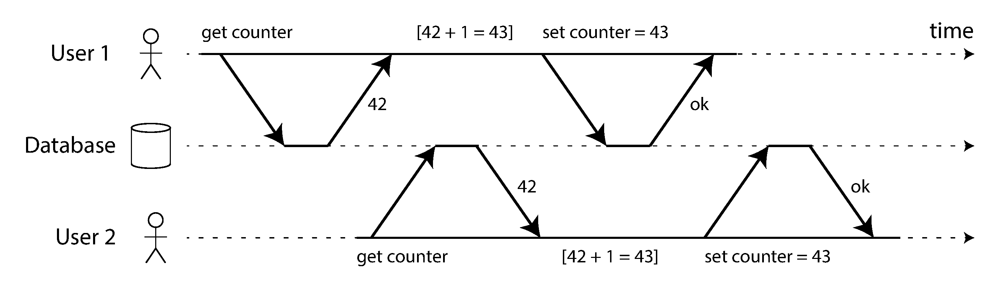

##### Single-Object and Multi-Object Operations — 한 record와 여러 record

- 단일 record의 atomic write는 데이터가 반쯤 기록되는 일을 막음
- 여러 record·secondary index·중복 데이터의 정합성을 함께 맞추려면 더 넓은 transaction 범위가 필요할 수 있음
- isolation이 부족하면 다른 transaction이 여러 object의 변경 중 일부만 읽을 수 있음

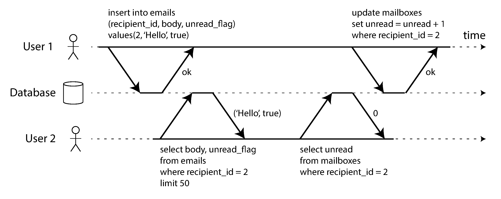

- atomicity는 실패 후 일부 변경만 남는 문제를 다룸. 뒤의 변경이 실패하면 앞서 수행한 변경도 취소해야 함

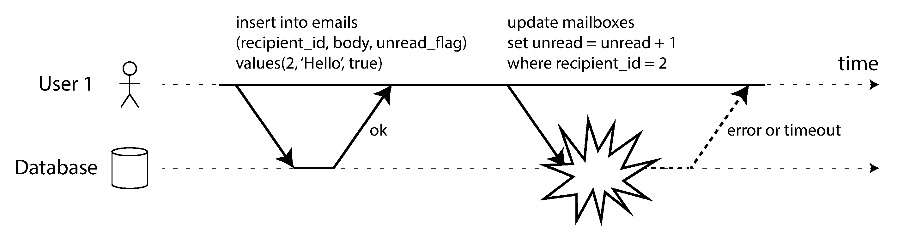

- commit 응답만 유실되면 실제 완료 여부가 불확실함. 무조건 retry하면 중복 효과가 생길 수 있음
- 과부하 시 retry는 backoff 등이 필요함. 영구 오류는 재시도만으로 해결되지 않음
- database 밖으로 보낸 메일·외부 요청은 transaction abort로 자동 취소되지 않음

 

#### Weak Isolation Levels — 무엇이 여전히 잘못될 수 있는지 확인

- 약한 isolation은 일부 동시성 문제만 막음
- 같은 이름의 isolation이라도 제품·버전·query 종류에 따라 동작이 다를 수 있음

##### Read Committed — 미완료 변경을 읽거나 덮어쓰지 않기

- 책에서 설명하는 read committed는 dirty read와 dirty write를 막음
- dirty read는 다른 transaction의 미완료 값을 읽는 것임. 나중에 rollback되면 존재하지 않는 기록을 근거로 판단한 셈이 됨

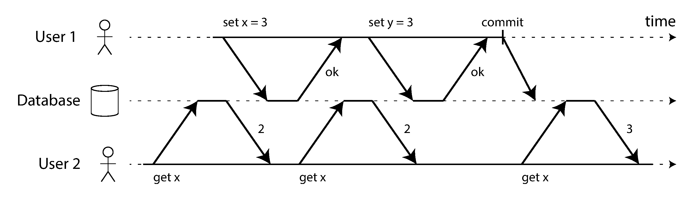

- dirty write는 다른 transaction이 아직 완료하지 않은 값을 덮어쓰는 것임
- 일반적인 구현은 쓰기 lock과 이전 committed version을 조합함

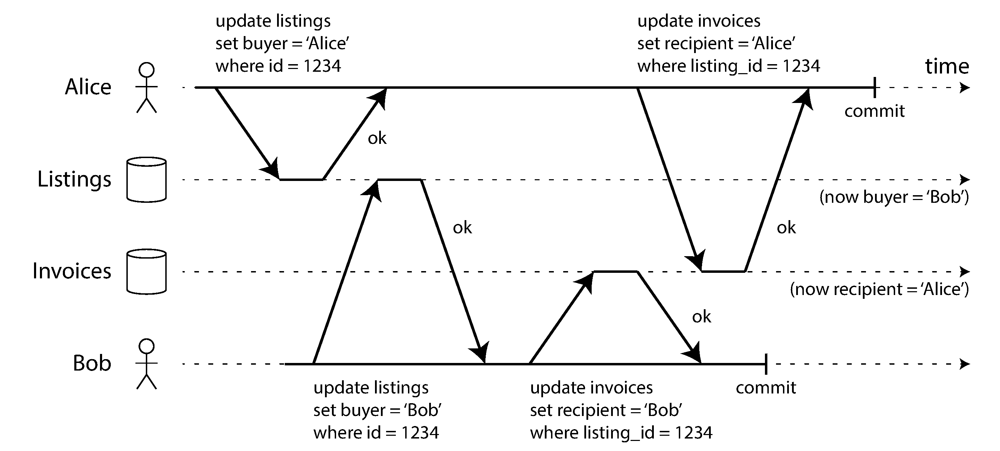

- 각 query가 다른 시점을 볼 수 있고, read-modify-write의 lost update도 남을 수 있음

##### Snapshot Isolation and Repeatable Read — 같은 시점의 자료 읽기

- read skew는 한 transaction이 서로 다른 시점의 데이터를 조합해 읽는 현상임
- 예를 들어 두 계좌 사이 이체 중 양쪽 잔액을 서로 다른 시점에 읽으면 합계가 맞지 않을 수 있음

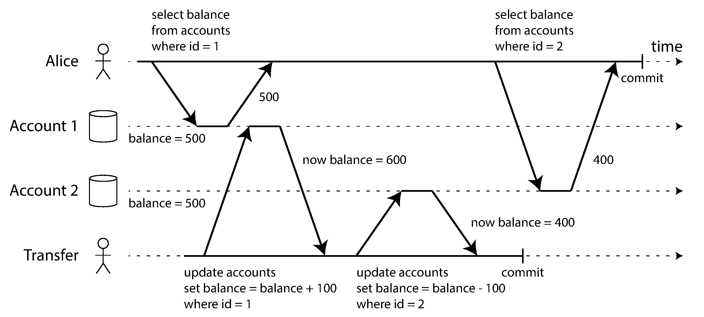

- snapshot isolation은 일정한 snapshot을 기준으로 읽게 함. backup·분석·무결성 검사에 유용함
- MVCC는 여러 version을 보관하고 각 transaction에 보이는 version을 선택하는 구현 방식임
- 이전 version을 유지하므로 reader와 writer의 충돌을 줄일 수 있음. 오래된 snapshot은 version 정리를 늦출 수 있음

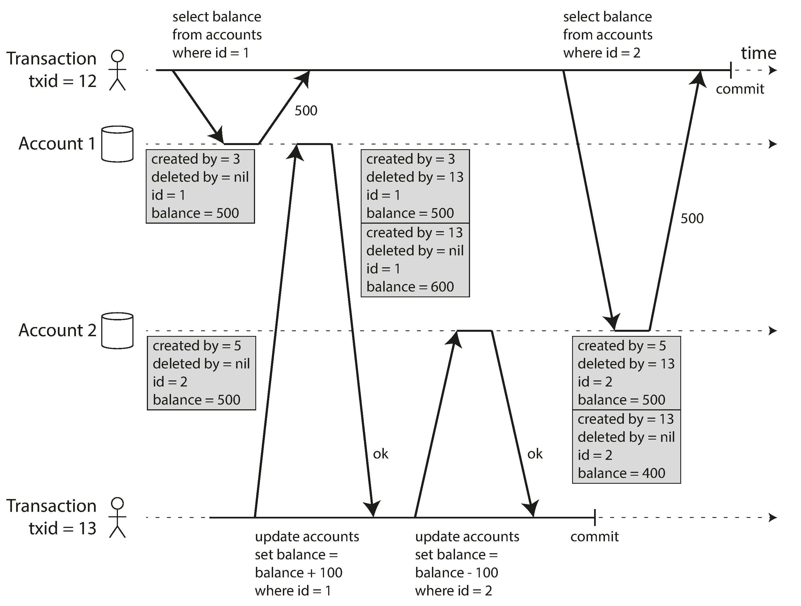

- repeatable read라는 이름만으로 snapshot isolation·serializability를 동일시하면 안 됨
- 확인한 [PostgreSQL 공식 문서](https://www.postgresql.org/docs/current/transaction-iso.html)는 repeatable read에서도 serialization anomaly가 가능하고, serializable을 별도로 제공한다고 설명함. 오류가 나면 transaction 전체를 다시 실행해야 함

##### Preventing Lost Updates — 같은 값을 읽고 덮어쓰는 문제

- lost update는 같은 과거 값을 읽은 뒤 각각 수정하면서 한쪽 변경이 사라지는 현상임
- 대응: atomic update, 관련 row의 명시적 lock, 충돌 감지 후 abort, version을 조건으로 한 compare-and-set 등
- compare-and-set은 조건 검사와 변경이 원자적이어야 함. stale snapshot의 비교만으로는 충분하지 않을 수 있음
- multi-leader·leaderless에서는 여러 변경을 보존해 병합하는 접근도 필요함. last write wins는 유실을 막는 방법이 아님

##### Write Skew and Phantoms — 다른 row를 바꿔도 규칙이 깨짐

- write skew는 같은 조건을 읽은 두 transaction이 서로 다른 row를 바꿔 invariant를 깨뜨리는 현상임
- 책에서는 두 당직 의사가 각각 다른 의사가 남아 있다고 보고 모두 당직에서 빠짐
- 정비 비유로는 “최소 한 명은 배정돼야 함”을 각자 확인하고 서로 다른 배정 기록을 해제하는 상황임

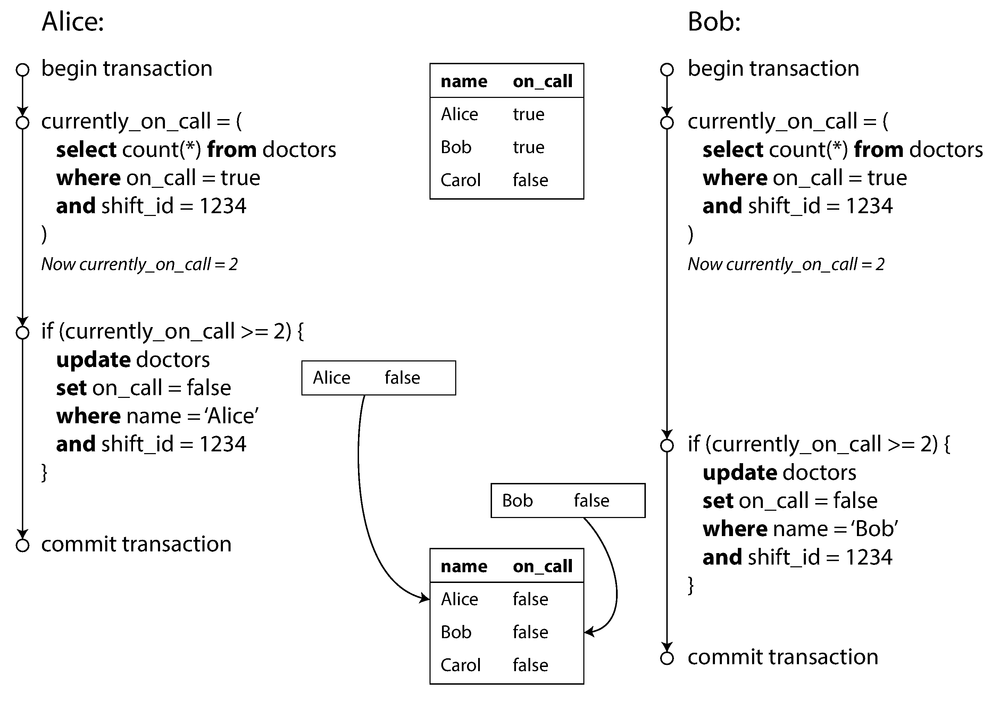

- snapshot isolation의 동일 row 충돌 감지만으로는 일반적인 write skew를 막지 못함
- phantom은 다른 쓰기가 검색 조건의 결과 집합을 바꾸는 문제임. 없는 예약을 확인한 뒤 동시에 예약을 넣는 경우가 예임
- 실제 row만 lock하면 아직 없는 row의 삽입을 막지 못할 수 있음
- serializable isolation, 조건 범위의 lock, 공통으로 lock할 record를 만드는 방식 등을 검토함

 

#### Serializability — 하나씩 실행한 것과 같은 결과

- 동시 실행의 결과가 어떤 순차 실행 순서와 같아야 한다는 보장임
- 실제 시간을 따라 최신 값을 읽는 linearizability와는 별개임. 관련 차이는 9장에서 다룸
- 순차 실행 자체의 업무 코드가 틀렸다면 serializability만으로 올바르게 되지는 않음

##### Actual Serial Execution — 실제로 하나씩 실행

- 짧고 빠른 transaction을 한 thread에서 처리하면 동시 실행의 충돌을 피할 수 있음
- 사용자 입력이나 왕복 통신을 기다리며 전체 실행을 막지 않도록 transaction logic을 묶어서 실행하는 방식이 사용됨

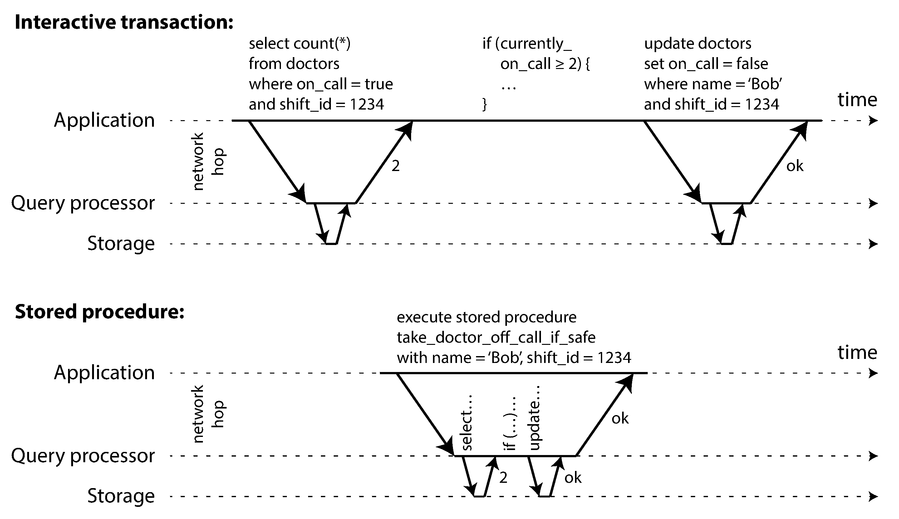

- active data가 memory에 있고 transaction이 짧으면 적합할 수 있음
- 여러 partition에서 독립 실행하면 처리량을 늘릴 수 있지만, cross-partition transaction은 조정 비용이 생김

##### Two-Phase Locking (2PL) — 충돌하는 접근을 기다리게 하기

- 읽기는 shared lock, 쓰기는 exclusive lock을 사용함. 충돌하는 접근은 대기함
- 기본 2PL은 lock을 획득하는 단계와 해제하는 단계를 나눔. 책의 설명은 lock을 transaction 끝까지 유지하는 strict한 방식에 초점을 둠
- deadlock이 나면 일부 transaction을 abort하고 retry해야 함. 느린 transaction이 다른 작업의 지연을 키울 수 있음
- **2PL은 격리 기법이며, 9장의 2PC는 여러 참여자의 commit 결정 절차임**
- phantom까지 막으려면 row뿐 아니라 predicate 또는 index range를 보호해야 함. 범위를 넓게 잡으면 불필요한 대기가 늘 수 있음

##### Serializable Snapshot Isolation (SSI) — 실행 후 위험한 의존성 감지

- snapshot을 읽으며 진행하고, 읽기·쓰기 의존성에서 순차 실행을 깨뜨릴 위험을 감지해 일부 transaction을 abort함
- 오래된 값을 읽은 모든 transaction을 무조건 취소하는 방식은 아님. 어떤 의존 관계가 형성됐는지가 중요함

###### Detecting Stale MVCC Reads — snapshot에 보이지 않은 변경

- 읽을 때 snapshot에서 제외한 동시 쓰기가 이후 commit될 수 있음. 이런 읽기·쓰기 관계를 추적해 순차 실행을 깨뜨릴 위험을 판단함

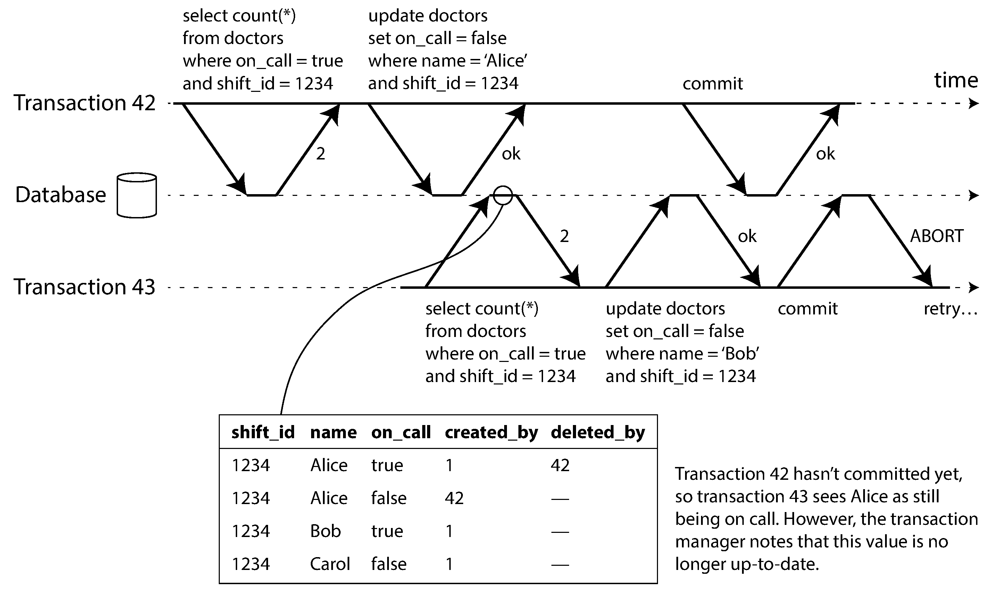

###### Detecting Writes That Affect Prior Reads — 읽었던 범위의 변경

- 다른 transaction이 앞선 query의 검색 범위를 바꾸는 경우도 추적해야 함. SSI의 읽기 추적은 2PL처럼 그 쓰기를 미리 막기 위한 lock과는 다름

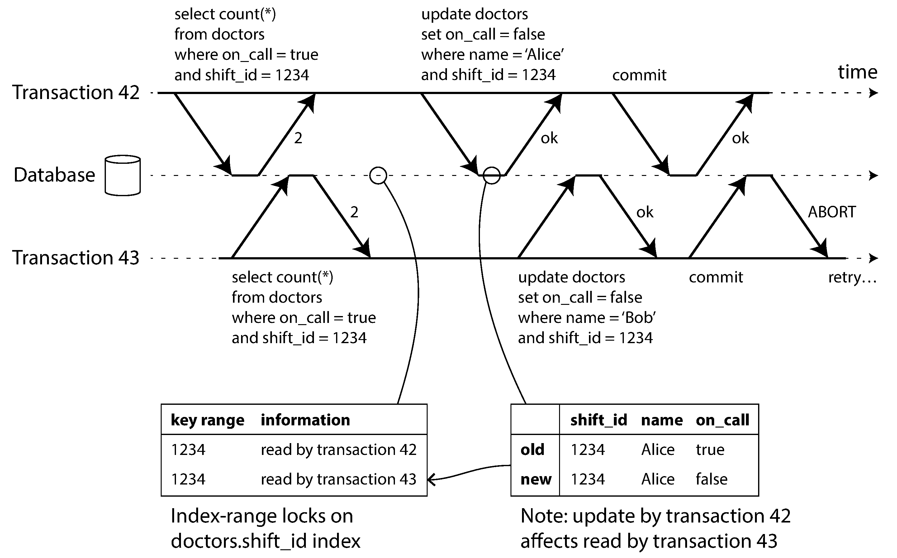

###### Performance of Serializable Snapshot Isolation — 대기와 재시도 비용

- 2PL처럼 모든 충돌 가능성을 미리 막는 대신 retry 비용을 감수하는 optimistic 접근임
- reader·writer 간 대기를 줄이지만, 쓰기 충돌과 기타 lock이 모두 사라지는 것은 아님
- 경합이 높거나 transaction이 길면 abort·retry 비용이 커질 수 있음

 

#### Summary — 정리

- atomicity는 부분 반영, isolation은 동시 실행의 간섭을 다룸
- read committed·snapshot isolation에는 여전히 남는 anomaly가 있음
- serializability는 실제 순차 실행, 2PL, SSI 등으로 구현할 수 있으며 대기·재시도·확장 비용이 다름
- 업무 invariant와 실제 database 보장을 함께 확인해야 함
