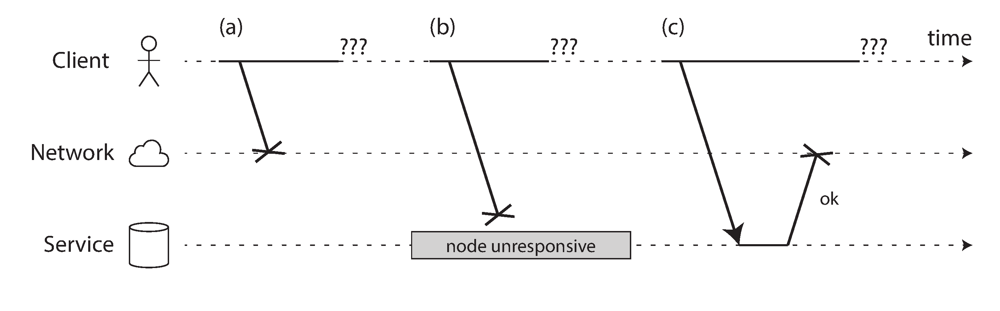
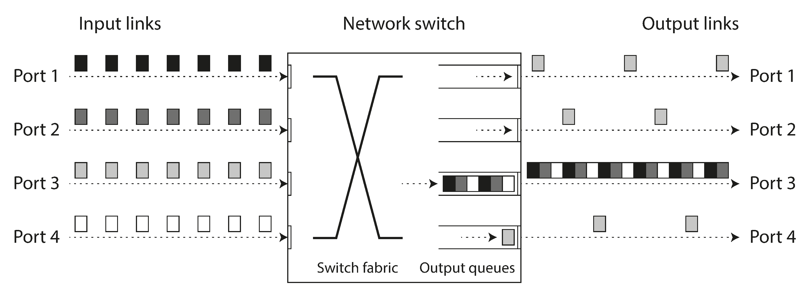
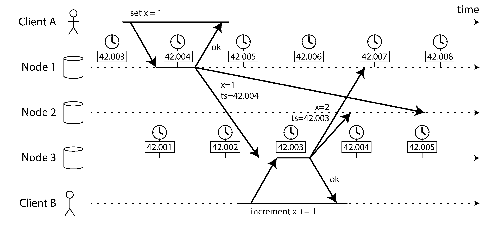
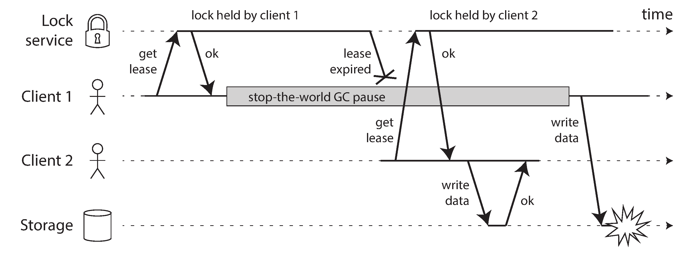
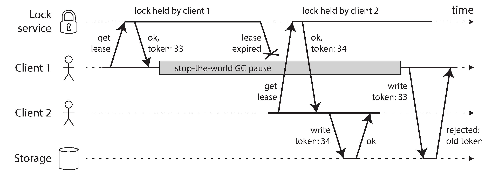

## Designing Data-Intensive Applications

### 8장. The Trouble with Distributed Systems

- 원문: 초판, 본문 pp. 273–312 / PDF pp. 295–334. 참고문헌은 PDF p. 334부터 시작함
- 핵심: 응답 없음·시계·자기 상태에 대한 판단만으로 다른 node의 실제 상태를 확정할 수 없음
- 정비 관점: 다른 기지의 회신이 없다는 사실과 그 작업이 수행되지 않았다는 판단을 구분하는 문제와 유사함

 

#### Faults and Partial Failures — 일부만 실패하는 상태

- 분산 시스템은 일부 node가 정상인 동안 다른 node·network만 실패할 수 있음
- 실패한 작업과 성공한 작업이 섞이고, 같은 요청을 반복해도 timing에 따라 결과가 달라질 수 있음
- 불확실한 상태에서의 재시도·복구가 설계의 일부임

##### Cloud Computing and Supercomputing — 중단을 다루는 방식

- 일부 계산 작업은 node 장애 시 전체 job을 중단하고 checkpoint에서 다시 시작할 수 있음
- 온라인 데이터 서비스는 전체를 멈추기 어려우므로 정상인 부분이 계속 동작하도록 설계함
- 책은 두 환경의 전형적인 목표를 비교함. 모든 cloud·고성능 계산 시스템이 동일하다는 분류는 아님

 

#### Unreliable Networks — 전달과 처리 여부가 불확실함

- 일반적인 asynchronous packet network에서는 전송 지연의 엄격한 상한을 기대하기 어려움
- 응답이 없을 때 request 유실, 수신 측 중단, 처리 지연, response 유실을 구별하지 못할 수 있음
- 원격에서 작업이 완료됐어도 호출자는 timeout을 볼 수 있음

##### Network Faults in Practice — 내부 network도 고장남

- cable·switch·routing·firewall·OS 등에서 단절·지연이 발생할 수 있음
- 오류 응답 자체와 복구 후 데이터가 깨지는 문제를 구분해야 함
- 실제 fault를 주입해 감지·재시도·복구 경로가 가정대로 동작하는지 확인할 수 있음

##### Detecting Faults — 감지 결과는 의심일 수 있음

- connection 오류나 관리 정보는 도움이 되지만 항상 전달되지는 않음
- transport 연결 상태만으로 업무 작업의 완료를 확정할 수 없음
- timeout은 “정해진 시간 내 응답을 못 받음”이라는 관측임. 원격 node의 사망 증명은 아님

##### Timeouts and Unbounded Delays — 감지 속도와 오판의 교환

- 긴 timeout은 실제 장애의 대응을 늦추고, 짧은 timeout은 정상 node를 장애로 오인할 수 있음
- 오판한 failover와 retry는 이미 바쁜 시스템에 부하를 더할 수 있음
- 고정된 정답보다 지연 분포·업무 영향·부하 변화를 기준으로 결정해야 함
- switch·OS queue, TCP 재전송, CPU scheduling, VM 정지 등이 지연을 키움

##### Synchronous Versus Asynchronous Networks — 시간 상한의 가정

- 회선과 대역폭을 예약하는 방식은 예측 가능한 전달 시간을 만들기 쉬움
- packet switching은 자원을 효율적으로 공유하지만 queueing과 지연 변동이 생김
- 특별한 보장이 없는 network에 일정한 최대 지연을 가정하면 안전성 논리가 깨질 수 있음

 

#### Unreliable Clocks — 서로 다른 장비의 시간이 다름

- clock은 drift, 동기화 오차, 설정 변경 등의 영향을 받음
- 시간 표시는 사람이 읽기 좋은 기록이지만, 그것만으로 event의 인과 순서를 확정할 수는 없음

##### Monotonic Versus Time-of-Day Clocks — 시각과 경과 시간 구분

| clock | 용도 | 한계 |
| --- | --- | --- |
| time-of-day | 날짜·시각 기록 | 보정 때문에 앞뒤로 jump할 수 있음 |
| monotonic | 경과 시간·timeout 측정 | 다른 장비의 절대값과 직접 비교 불가 |

- monotonic clock도 process가 제시간에 실행되게 만드는 기능은 아님

##### Clock Synchronization and Accuracy — 동기화에도 오차가 남음

- NTP 등을 사용해도 network 지연, clock drift, 동기화 서버 문제 등으로 오차가 남음
- clock 정확성에 의존하는 구조라면 offset을 측정하고 허용 범위를 벗어났을 때의 처리를 정해야 함
- 책의 clock 오차 수치는 당시 사례임. 특정 환경의 현재 보장값으로 사용하지 않음

##### Relying on Synchronized Clocks — 시각을 정확성 근거로 쓸 때

- last write wins를 물리 timestamp로 정하면 인과적으로 나중인 쓰기가 더 작은 값을 받아 버려질 수 있음

- 순서가 목적이면 logical clock 등으로 의존성을 표현하는 방법을 검토함
- 물리 clock을 쓸 때는 한 시점보다 오차 구간으로 해석해야 함
- 책의 TrueTime 사례는 uncertainty를 드러내고 필요한 만큼 기다려 transaction의 시간 순서를 보장하는 접근임
- 정확한 clock 사용에는 동기화·오차 상한·대기 절차라는 전제가 함께 필요함

##### Process Pauses — 멈췄던 process가 다시 움직일 때

- GC, scheduling, page fault, VM 정지 등으로 process가 오래 멈출 수 있음
- 중단 전 유효했던 lease가 그사이 만료돼 다른 client에 넘어갈 수 있음
- 재개한 client가 자신이 여전히 권한을 가졌다고 생각하면 오래된 작업이 실행됨

- 대응은 resource가 fencing token을 검사하는 것임. 새 권한 발급마다 더 큰 token을 부여함
- resource는 이미 확인한 token보다 작은 요청을 거부함. client 측의 유효기간 확인만으로는 충분하지 않음
- 작업 권한이 새 담당자에게 넘어간 뒤 이전 담당자의 지연된 변경을 저장소가 거부하는 구조로 이해할 수 있음

- hard real-time 보장은 별도 제약과 비용이 필요함. 일반적인 데이터 서비스의 빠른 응답 목표와 구분해야 함
- GC·pause 완화는 지연을 줄이는 수단임. 예외적인 pause가 생겨도 안전한 설계가 필요함

 

#### Knowledge, Truth, and Lies — node의 믿음과 시스템의 결정

- 한 node는 자신의 관측만 알 수 있음. 자신이 leader라고 믿는 것과 시스템이 그 권한을 인정하는 것은 다름

##### The Truth Is Defined by the Majority — 겹치는 과반수

- 고정된 구성원 집합의 두 과반수는 반드시 겹침. 합의 절차는 이 교집합을 활용함
- 과반수 투표라는 형식만으로 모든 알고리즘이 안전해지는 것은 아님. 이전 결정의 보존·term 규칙 등이 함께 필요함
- leader나 lock holder가 고립됐다가 복귀하면 새로운 권한 상태에 맞춰 동작해야 함
- fencing은 이때 resource에 대한 오래된 요청을 차단하는 수단임

##### Byzantine Faults — 임의의 잘못된 행동

- Byzantine fault는 node가 서로 다른 거짓 응답을 보내는 등 임의로 동작하는 실패 모델임
- crash·지연만 가정한 consensus는 이런 행동을 견딘다고 볼 수 없음
- 이를 견디는 알고리즘은 추가 비용과 다른 신뢰 가정이 필요함
- 일반적인 시스템도 checksum, 입력 검증, 인증 등으로 데이터 손상과 잘못된 요청에 대비해야 함

##### System Model and Reality — 보장이 성립하는 가정

| 구분 | 모델 | 가정 |
| --- | --- | --- |
| timing | synchronous | 지연·실행 시간 등에 정해진 상한 |
| timing | partially synchronous | 결국 진행에 필요한 시간 조건이 성립 |
| timing | asynchronous | 시간 상한을 두지 않음 |
| node | crash-stop | 중단 후 복귀하지 않음 |
| node | crash-recovery | 중단 후 durable state로 복귀 가능 |
| node | Byzantine | 임의의 잘못된 행동 가능 |

- safety는 잘못된 결정 같은 일이 일어나지 않는 성질임
- liveness는 작업이 언젠가 완료되는 성질임
- 안전성을 유지하며 일시적으로 멈추는 것과, 서로 다른 결정을 완료하는 것을 구분해야 함
- 증명이 가정하는 저장·전달·실행 조건이 실제 구현에서 유지되는지 확인해야 함

 

#### Summary — 정리

- timeout, timestamp, client의 권한 주장은 각각 한계가 있음
- 지연과 pause를 줄이는 것에 더해, 실제로 발생했을 때도 잘못된 쓰기를 막아야 함
- 알고리즘의 safety와 liveness가 어떤 장애·시간 가정에 의존하는지 확인하는 것이 분산 설계의 출발점임
