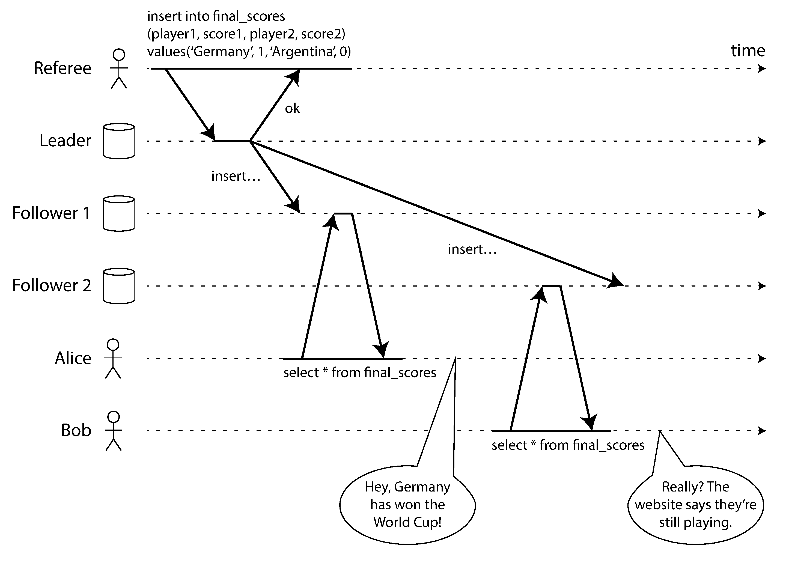
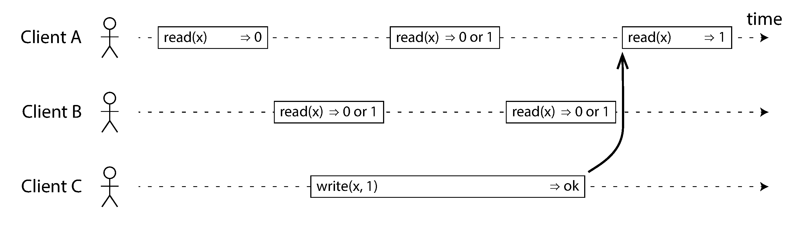
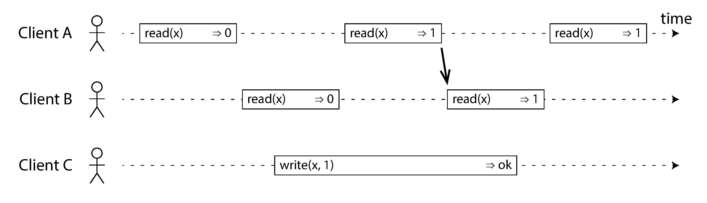
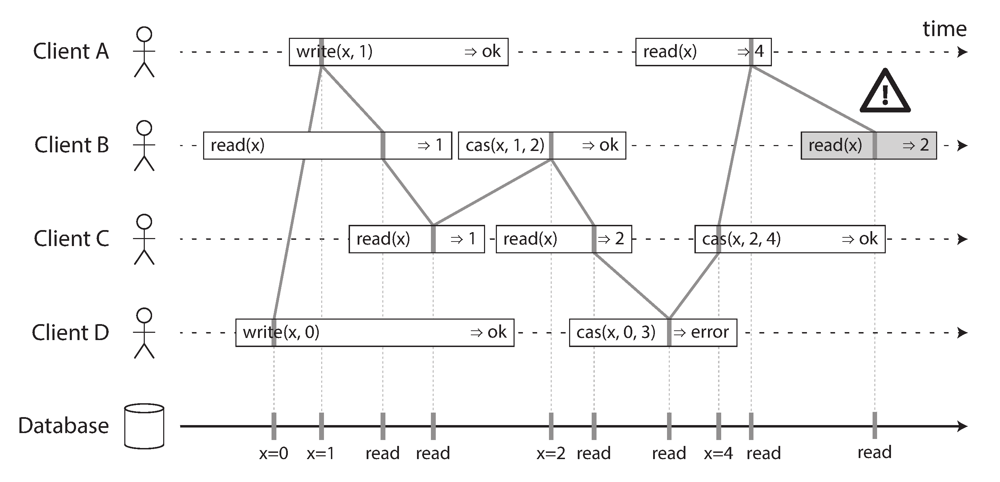
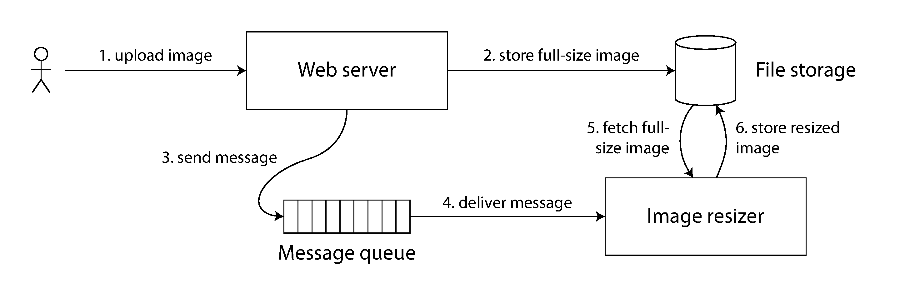
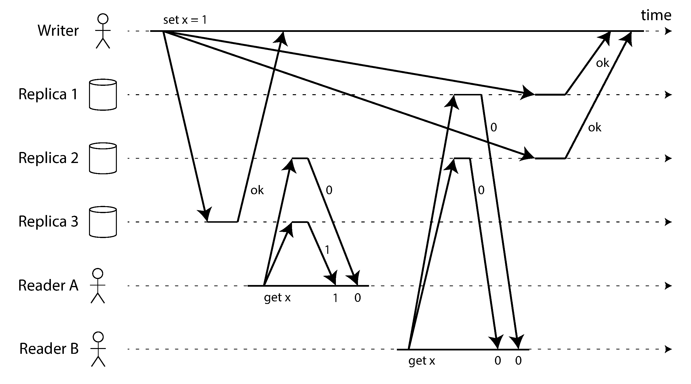
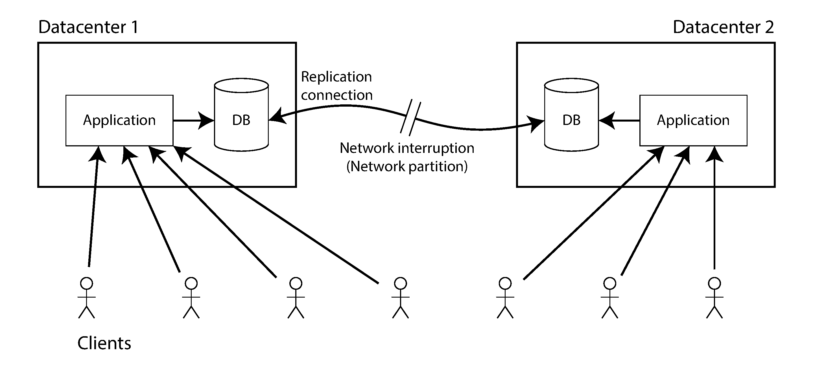
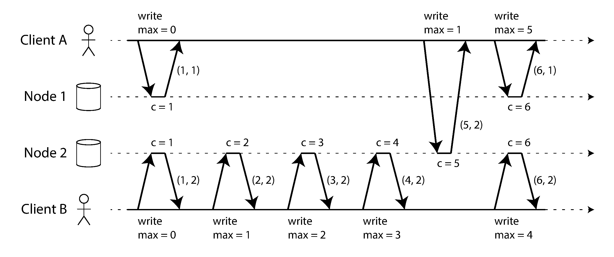
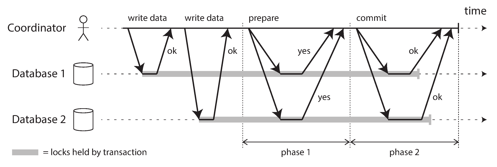
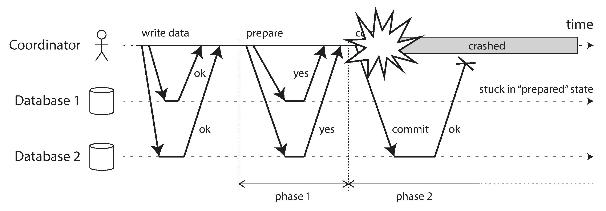

## Designing Data-Intensive Applications

### 9장. Consistency and Consensus

- 원문: 초판, 본문 pp. 321–375 / PDF pp. 343–397. 참고문헌은 PDF p. 397부터 시작함
- 핵심: 최신성, 인과 순서, 전체 순서, commit 합의는 서로 다른 보장임
- 정비 관점: 기록 전달 순서를 맞추는 일과, 여러 기지가 같은 작업의 최종 상태를 확정하는 일을 구분하는 문제와 유사함

 

#### Consistency Guarantees — 읽기·쓰기에 기대할 규칙

- eventual consistency만으로는 읽은 값이 얼마나 오래됐는지 알 수 없음
- 강한 보장은 애플리케이션의 추론을 단순하게 하지만 지연·통신·availability 비용이 있음
- transaction isolation은 동시 transaction의 간섭을, 이 장의 consistency model은 복제된 데이터의 읽기·쓰기를 주로 다룸

 

#### Linearizability — 하나의 최신 복사본처럼 보이기

- 각 operation이 호출과 응답 사이 한순간에 적용된 것처럼 보여야 함
- 완료된 operation이 뒤에 시작한 operation보다 먼저 오는 실제 시간 순서를 지켜야 함
- 정비 비유로는 한 사람이 변경을 확인한 뒤 다른 사람이 조회하면 그보다 과거 상태로 돌아가지 않는 기준 기록임
- 이후에 다시 수정됐다면 그 더 최신 변경을 볼 수 있음. 과거의 한 값을 영구히 유지한다는 뜻은 아님

##### What Makes a System Linearizable? — operation을 놓을 수 있는 순서

- read와 write가 시간상 겹치면 read는 이전 값이나 새 값을 반환할 수 있음

- 한 read가 새 값을 반환한 뒤 시작한 read는, 그 사이 다른 쓰기가 없다면 이전 값으로 돌아가면 안 됨

- 모든 operation에 효과 발생 시점을 하나씩 배치했을 때 실제 시간과 객체의 규칙을 모두 만족해야 함

- serializability는 transaction들이 어떤 순차 실행과 같은지를 다룸. 그 순서가 실제 완료·호출 순서와 같다는 조건은 별도임
- serializability에 실제 시간 순서까지 요구하는 보장이 strict serializability임

##### Relying on Linearizability — 최신성이 업무의 정확성을 좌우할 때

- lock·leader election, uniqueness constraint, 여러 통신 경로의 순서 의존이 대표 사례임
- 같은 자원의 권한이나 이름을 두 요청 모두 성공시켜서는 안 될 때 원자적인 판정이 필요함
- 모든 화면·집계에 같은 강도가 필요한 것은 아님. 늦은 조회를 허용할 기능은 구분할 수 있음
- lease 기반 권한은 선형적인 획득 절차에 더해 fencing 등 오래된 holder를 막는 장치도 필요함

- file을 저장한 뒤 queue에 알렸어도 소비자가 읽는 replica에는 file 변경이 도착하지 않았을 수 있음
- version·causal dependency를 전달해 기다리게 하는 대안도 있지만 추가 규칙이 필요함

##### Implementing Linearizable Systems — 복제 방식만으로 판단하지 않기

- single-leader도 stale leader의 읽기나 안전하지 않은 failover가 있으면 선형적이지 않을 수 있음
- 여러 leader가 독립적으로 쓰는 구조는 일반적으로 이 보장을 제공하기 어려움
- leaderless quorum도 응답 집합의 교집합만으로는 충분하지 않음. 읽기·쓰기의 추가 절차가 필요할 수 있음

- consensus 기반 log도 모든 읽기 경로가 자동으로 최신인 것은 아님. 읽기 API의 보장까지 확인해야 함
- 예를 들어 [etcd 공식 API 보장](https://etcd.io/docs/v3.6/learning/api_guarantees/)은 기본 linearizable read와 낮은 지연을 위한 serializable read의 차이를 설명함

##### The Cost of Linearizability — 단절과 지연 비용

- network partition 중 모든 비장애 node가 요청을 계속 완료하는 availability와 linearizability를 동시에 보장할 수는 없음
- 책의 CAP은 이 상황을 설명함. “세 속성 중 아무 두 개 선택”이라는 제품 분류로 단순화하면 부정확함
- 여기서 availability는 일반적인 월간 가동률 지표와 같은 의미가 아님

- 정상 통신 중에도 보장에 필요한 통신·확인 때문에 지연 비용이 있음
- CAP만으로 성능·모든 장애 유형·업무 일관성을 설명할 수는 없음

 

#### Ordering Guarantees — 필요한 순서의 강도

- 원인과 결과만 맞출지, 모든 event에 하나의 순서를 부여할지 구분해야 함

##### Ordering and Causality — 원인보다 결과가 먼저 오지 않기

- B가 A를 읽거나 A의 결과에 의존하면 A가 B보다 먼저 와야 함
- causal order는 partial order임. 서로 의존하지 않는 concurrent event는 순서를 강제하지 않아도 됨
- linearizability는 더 강한 실제 시간 순서를 요구함
- causal consistency를 구현하려면 먼저 적용돼야 할 변경을 추적하고 도착할 때까지 기다릴 수 있어야 함

##### Sequence Number Ordering — 순번으로 순서 표현

- single-leader log는 변경에 순서를 부여함
- 여러 node가 독립 counter·시각·번호 구간을 쓰는 것만으로는 인과 순서가 자동 보존되지 않음
- Lamport timestamp는 각 node의 counter와 수신한 counter를 반영해 인과적으로 뒤인 event에 더 큰 번호를 부여함
- 같은 counter는 node ID로 구분해 total order를 만들 수 있음

- A가 B보다 인과적으로 앞서면 timestamp도 작음. 반대 방향은 성립하지 않음. 작은 timestamp만으로 인과관계를 알 수는 없음
- version vector는 동시성 판별에, Lamport timestamp는 인과관계에 맞는 정렬에 초점이 있음
- timestamp가 있다고 순서가 지금 확정됐다는 뜻은 아님. 아직 도착하지 않은 더 앞선 요청이 있을 수 있음

##### Total Order Broadcast — 같은 message를 같은 순서로 확정

- 올바른 node들이 같은 message를 같은 순서로 deliver하도록 하는 보장임
- 장애 중 진행이 멈출 수 있어도 이미 정한 순서를 뒤집어서는 안 됨
- 한 복제본에서 deliver한 message를 다른 정상 복제본에서도 결국 deliver하는 신뢰성 조건이 필요함
- 모든 replica가 같은 순서로 deterministic state machine을 실행하면 같은 상태를 유지할 수 있음
- 순서 보장만으로 모든 replica가 같은 시각에 적용하거나 모든 읽기가 최신이 되는 것은 아님
- total order broadcast와 선형적인 원자 연산·consensus는 적절한 가정과 구성 아래 서로 구현할 수 있는 밀접한 관계임

 

#### Distributed Transactions and Consensus — 여러 node의 결정 맞추기

- consensus는 여러 제안 중 같은 값을 결정하는 문제임. leader 선정과 log entry 확정 등에 사용됨
- atomic commit은 transaction 참여자들이 commit 또는 abort 결과를 일치시키는 문제임
- 완전히 asynchronous한 모델에서 crash 가능성이 있으면 deterministic consensus의 종료를 항상 보장할 수 없다는 것이 FLP 결과의 핵심임
- 실제 알고리즘은 안전성과 별도로, 진행에 필요한 시간·장애 감지 등의 조건을 둠

##### Atomic Commit and Two-Phase Commit (2PC) — 모두 완료하거나 모두 취소

1. coordinator가 participant들에게 prepare를 요청함
2. participant는 나중에 결정을 수행할 수 있도록 상태를 durable하게 기록하고 yes 또는 no로 응답함
3. 전원이 yes이면 coordinator는 commit 결정을 durable하게 기록함. 준비가 완료되지 않으면 abort를 결정할 수 있음
4. 결정을 participant에게 반복 전달해 최종 상태를 맞춤

- yes를 보낸 participant는 이후 timeout만으로 독자적인 abort를 결정할 수 없음
- coordinator가 다른 참여자에게 commit을 알렸을 가능성이 있기 때문임
- prepare 후 결정을 모르는 상태에서 coordinator가 중단되면 in-doubt로 대기할 수 있음. 이것이 2PC의 blocking 문제임

##### Distributed Transactions in Practice — 보장 범위와 운영 비용

- 하나의 database 내부 transaction과 서로 다른 database·broker를 묶는 transaction은 구현·운영 조건이 다름
- XA는 여러 시스템의 transaction manager와 participant를 연결하는 interface임
- in-doubt 상태에서 lock이 유지되면 다른 업무도 멈출 수 있음. coordinator의 durable log와 복구가 중요함
- coordinator log 유실 후의 수동 결정은 atomicity를 깨뜨릴 수 있음
- message ack와 database 변경을 묶어도, 참여하지 않는 외부 전송·물리적 효과까지 rollback되는 것은 아님
- “exactly once”라는 설명은 포함된 저장소·message·side effect의 범위를 명시해야 함

##### Fault-Tolerant Consensus — 일부 장애에도 같은 결정을 유지

- agreement: 서로 다른 값을 결정하지 않음
- integrity: 한 합의 instance에서 결정을 번복하지 않음
- validity: 결정값은 허용된 제안에서 나옴
- termination: 필요한 진행 조건 아래 정상 node가 결국 결정함
- Raft·Paxos·Zab 등은 이런 결정을 연속된 log로 구성하는 데 활용됨
- term·epoch와 quorum을 사용하고, 새 leader가 이전에 확정된 결정을 이어받도록 해야 함
- 큰 term만 쓰거나 과반수만 받는 것으로 충분하지 않음. log 선택·선거·복구 규칙이 함께 필요함
- 일반적인 crash-fault majority 구성에서는 `2f+1` voting node로 `f`개 장애 후에도 과반수를 유지할 수 있음
- majority에 접근하지 못하는 쪽은 안전한 진행을 멈춰야 함. 구성원 변경도 교집합을 유지하는 별도 절차가 필요함

##### Membership and Coordination Services — 작은 기준 정보를 합의로 관리

- coordination service는 leader, 작업 소유권, partition 배정 등 작은 기준 정보를 관리하는 데 사용됨
- 장애 감지·변경 알림과 합의를 결합해 업무를 재배정할 수 있음
- membership의 합의는 “현재 누구를 구성원으로 인정할지”의 결정임. 물리적으로 살아 있는지 완벽히 아는 것은 아님
- 단순 endpoint 조회는 stale 정보를 허용할 수도 있음. service discovery에 항상 consensus가 필요한 것은 아님

 

#### Summary — 정리

- linearizability는 최신성과 실제 시간 순서를, causal consistency는 의존 순서를 보장함
- 정렬 가능한 번호와 확정된 실행 순서는 다름
- 2PC는 원자적 commit을 조정하지만 대기 상태가 생길 수 있음
- consensus도 quorum 통신·장애 가정·안전한 읽기와 구성 변경 규칙에 따른 비용이 있음
