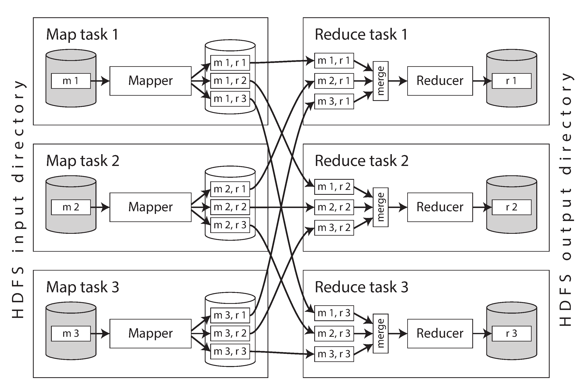
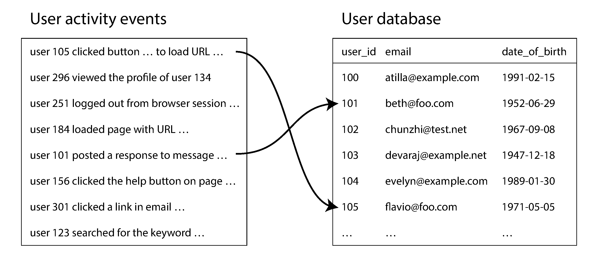
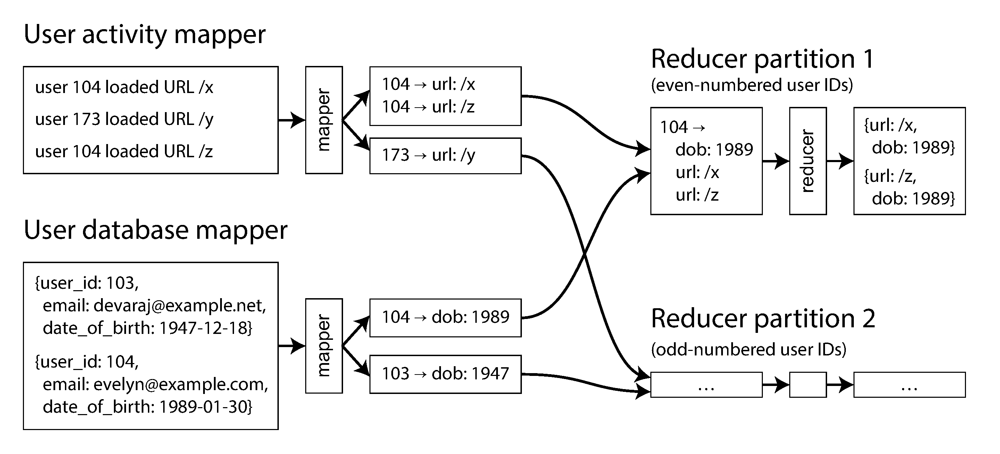

## Designing Data-Intensive Applications

### 10장. Batch Processing

- 원문: 초판, 본문 pp. 389–431 / PDF pp. 411–453. 참고문헌은 PDF p. 453부터 시작함
- 핵심: 범위가 정해진 입력에서 결과를 만들고, 실패한 계산을 다시 수행할 수 있게 함
- 정비 관점: 하루치 정비 기록을 확정한 뒤 기종·부품별 결함 통계를 재계산하는 작업과 유사함
- system of record는 기준 원본, derived data는 원본에서 다시 만들 수 있는 색인·집계·모델 등임

 

#### Batch Processing with Unix Tools — 작은 처리 단계를 연결

- batch는 크기와 끝이 있는 bounded input을 처리함
- 온라인 요청과 달리 즉시 응답보다 전체 처리 시간·throughput이 중요할 수 있음
- Unix 도구는 표준 입력·출력으로 연결하고, 각 단계는 한 가지 변환을 담당함

##### Simple Log Analysis — 읽기·분류·집계

- 책의 예시는 access log에서 URL을 추출하고, 정렬하고, 같은 값의 개수를 세어 상위 항목을 고름
- 처리 흐름: record 해석 → 필요한 field 선택 → grouping → 집계 → 결과 정렬임
- hash map 집계는 빠르지만 고유 key가 많으면 memory를 많이 사용함
- 정렬은 중간 결과를 disk에 내려 큰 입력을 처리할 수 있음. 입력 규모와 고유 key 수에 따라 비용이 달라짐
- log 형식이 바뀌면 field 해석도 바뀜. 저장 형식의 계약을 먼저 확인해야 함

##### The Unix Philosophy — 입출력 규약과 조립

- 한 도구는 한 가지 일을 하고, 출력은 다른 도구의 입력이 될 수 있어야 함
- 공통 interface는 도구의 구현과 연결 방식을 분리함
- 원본을 바꾸지 않고 결과를 별도 생성하면 중간 출력을 확인하고 다른 처리 방법을 시험하기 쉬움
- 정비 자료를 원본·추출 자료·집계 결과로 이어가듯, 단계별 입력과 결과를 확인할 수 있어야 함

 

#### MapReduce and Distributed Filesystems — 여러 장비에서 같은 흐름 실행

- distributed filesystem은 큰 file을 block으로 나누고 복제해 여러 node에 저장함
- MapReduce는 입력을 나눠 변환하고, 관련 key를 모아 집계함
- 책은 HDFS와 Hadoop을 대표 사례로 사용함. 제품의 현재 배포·설정 방식을 안내하는 장은 아님

##### MapReduce Job Execution — map, shuffle, reduce

1. 입력 file을 나눠 mapper가 읽음
2. mapper가 각 record를 key-value로 변환함
3. framework가 key별 partitioning·정렬·전송을 수행함. 이 재분배 과정이 shuffle임
4. reducer가 같은 key의 값들을 순서대로 받아 결과를 만듦
5. 각 task의 결과를 모아 job의 출력을 공개함

- 같은 key는 같은 reducer로 가야 함. mapper의 처리 순서와 전체 key 순서는 별개임
- 입력이 있는 node 근처에서 실행하면 전송을 줄일 수 있음
- 실패한 task는 다시 실행하고, 실패·중복 실행의 출력 중 하나만 최종 결과에 반영하도록 관리함
- 여러 job을 연결하면 앞선 job의 출력이 다음 job의 입력이 됨. 의존 관계와 시작 조건을 관리해야 함

##### Reduce-Side Joins and Grouping — 같은 key를 한곳에 모으기

- join key를 추출해 양쪽 dataset을 같은 reducer로 보내면 입력 배치가 달라도 관계를 결합할 수 있음
- row마다 원격 database를 조회하는 방식보다 대량 scan·shuffle이 적합할 수 있음

- sort-merge join은 같은 key의 양쪽 record를 인접하게 정렬해 결합함
- 같은 key의 값이 모두 memory에 들어간다고 가정해서는 안 됨. 입력의 출력 순서와 buffering을 조정해야 함

- grouping도 같은 원리임. 부품별 결함 건수처럼 같은 key를 모아 집계함
- hot key 하나에 데이터가 몰리면 reducer 하나가 병목이 됨
- 집계를 여러 단계로 나누거나 일부 입력을 복제하는 방법이 있으나, 연산의 결합 가능성과 정확성을 확인해야 함

##### Map-Side Joins — 입력 조건을 활용해 shuffle 줄이기

| 방식 | 전제 | 실행 |
| --- | --- | --- |
| broadcast hash join | 한쪽 입력이 작음 | 작은 입력을 mapper마다 memory에 올림 |
| partitioned hash join | 양쪽이 같은 key·규칙으로 분할됨 | 대응 partition 안에서 hash join |
| map-side merge join | 대응 partition이 같은 순서로 정렬됨 | 두 입력을 순차적으로 merge |

- 전제가 맞으면 reduce-side의 재분배·정렬 비용을 줄일 수 있음
- file 위치뿐 아니라 partition key·개수·정렬 기준도 데이터의 계약으로 관리해야 함
- 작은 입력도 mapper 수만큼 복제됨. 개별 memory 크기와 전체 배포 비용을 함께 봐야 함

##### The Output of Batch Workflows — 보고서 외의 결과

- batch 출력에는 검색 색인, key-value 조회용 데이터, 추천 결과 등도 포함됨
- 대량 결과를 온라인 database에 record별로 쓰면 운영 부하와 retry 문제가 생길 수 있음
- 새 dataset을 별도로 만든 뒤 완성된 version을 전환하는 방법은 부분 출력을 노출하지 않게 함
- 입력이 고정되고 계산이 재현 가능하면 잘못된 코드를 수정한 뒤 다시 실행해 복구할 수 있음
- 외부 메일 전송 같은 side effect는 task retry와 함께 반복될 수 있음. framework의 출력 보장 밖에서 따로 처리해야 함

##### Comparing Hadoop to Distributed Databases — 구현보다 실행 가정 비교

- MPP database도 분산 join·집계를 오래전부터 사용했음. MapReduce가 분산 분석의 최초 방식은 아님
- 전형적인 MPP는 분석 SQL과 관리된 schema, Hadoop은 다양한 file·입력과 사용자 처리 코드에 초점을 뒀음
- schema-on-read는 원본 적재를 유연하게 하지만 데이터 해석·검증 책임이 없어지는 것은 아님
- MapReduce의 잦은 materialization과 task 재시도는 자주 중단되는 환경에서 유리하지만 평상시 I/O 비용이 큼
- 책은 당시 시스템의 설계 가정을 비교함. 오늘날 모든 제품을 이 구분에 고정할 수는 없음

 

#### Beyond MapReduce — 중간 저장과 실행 모델 개선

- 단순한 map·reduce 조합으로 복잡한 계산을 표현하면 단계와 저장 비용이 늘어남
- dataflow engine과 고수준 query는 같은 논리를 더 효율적으로 실행하려는 접근임

##### Materialization of Intermediate State — 중간 결과를 어디에 둘지 결정

- materialization은 중간 결과를 나중에 읽을 수 있도록 저장하는 것임
- job마다 전체 결과를 filesystem에 쓰면 복구·재사용은 쉽지만 지연·I/O가 늘어남
- dataflow engine은 여러 operator를 DAG로 묶고 필요 없는 정렬·저장을 줄임
- operator 사이에 memory·network로 데이터를 전달해 pipeline 실행을 할 수 있음
- 장애 시에는 일부 결과를 다시 계산하거나 checkpoint에서 재개해야 함
- deterministic 계산과 고정 입력은 재실행의 의미를 유지하는 데 중요함. 현재 시각·난수·외부 조회가 달라지면 결과도 달라질 수 있음

##### Graphs and Iterative Processing — 반복 계산

- PageRank처럼 전체 graph를 반복 계산하는 작업은 단순한 일회성 join과 다름
- Pregel 계열의 bulk synchronous parallel 모델은 superstep마다 vertex가 message를 받고 상태를 바꿔 다음 message를 보냄
- 단계 사이 barrier로 진행을 맞추고, 장애 시 checkpoint·재실행을 사용할 수 있음
- vertex 배치는 통신량을 좌우함. 작게 처리할 수 있는 graph라면 분산 조정 비용이 더 클 수 있음

##### High-Level APIs and Languages — 논리와 실행 분리

- 고수준 API·선언적 query는 join·집계의 의도를 표현하고 실행 엔진이 배치를 최적화하게 함
- 같은 query를 다른 엔진으로 옮기거나 join 방법을 바꾸기 쉬워짐
- 임의 사용자 함수는 내부를 분석하기 어려워 최적화에 제약이 생길 수 있음
- 분석 SQL, 통계·machine learning, graph 등 영역별 연산을 제공하는 방향으로 발전함

 

#### Summary — 정리

- batch의 핵심은 고정된 원본으로부터 별도의 출력을 만드는 것임
- partitioning은 관련 데이터를 모으고, fault tolerance는 실패한 계산을 다시 수행하게 함
- 중간 결과를 얼마나 저장할지에 따라 정상 시 속도와 장애 시 재계산 비용이 달라짐
- 재시도 가능한 계산과 외부 side effect를 구분해야 함
