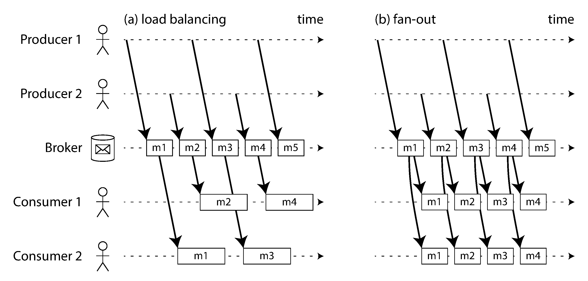
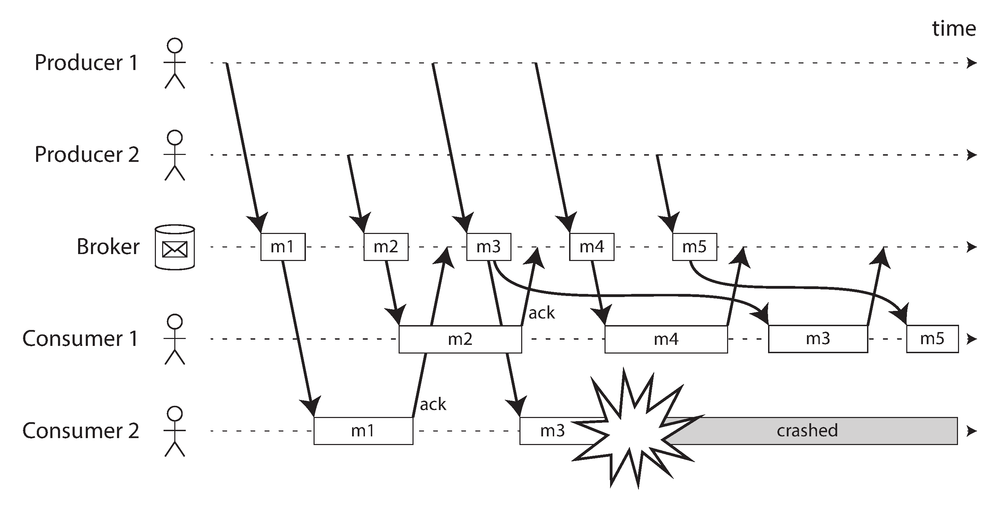
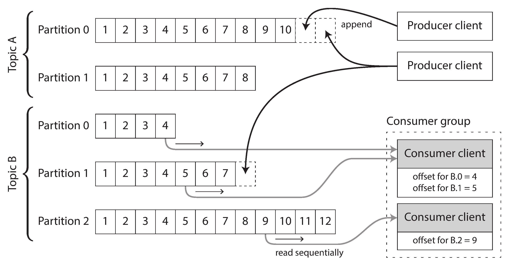
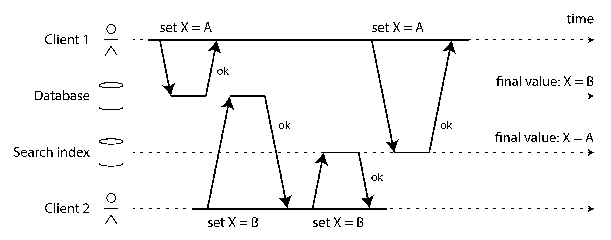
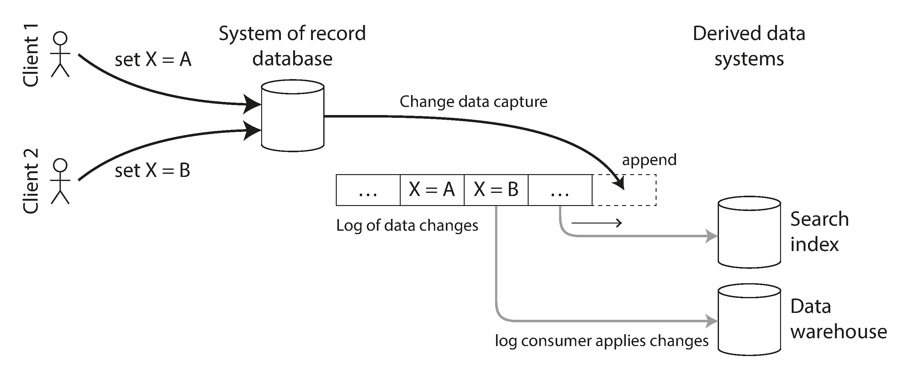
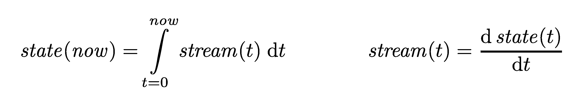
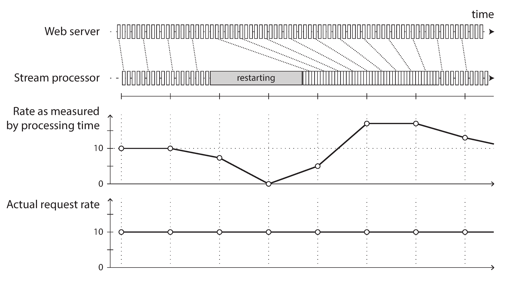

## Designing Data-Intensive Applications

### 11장. Stream Processing

- 원문: 초판, 본문 pp. 439–481 / PDF pp. 461–503. 참고문헌은 PDF p. 503부터 시작함
- 핵심: 끝없이 들어오는 event를 처리하면서 순서·시간·상태·재시도 의미를 관리함
- 정비 관점: 비행·점검·부품 교체 기록이 도착할 때마다 현황을 갱신하되, 늦은 보고와 중복 전송을 처리하는 문제와 유사함

 

#### Transmitting Event Streams — 발생한 사실을 전달하기

- event는 발생한 일을 나타내는 작은 record임. stream은 이런 record가 이어지는 입력임
- batch의 file과 달리 stream은 언제 끝날지 정해지지 않은 unbounded input임
- producer가 만들고 consumer가 읽음. 전달·보관·재처리 규칙이 처리 결과를 좌우함

##### Messaging Systems — 속도 차이와 장애를 흡수

- 생산자가 더 빠를 때 버릴지, 저장할지, 생산 속도를 제한할지 정해야 함
- node 중단 시 message를 잃어도 되는지, disk와 복제를 통해 보존할지도 정해야 함
- broker는 생산자와 소비자의 실행 시점을 분리하지만 무한한 보관·처리 능력을 제공하지는 않음
- load balancing은 여러 소비자가 일을 나눠 처리하고, fan-out은 독립된 소비자들이 같은 event를 받는 방식임

- ack는 처리가 끝났음을 알리는 신호임. 처리 중 consumer가 죽으면 broker가 재전달할 수 있음
- 외부 쓰기 후 ack 전에 중단되면 동일 message가 다시 실행될 수 있음
- 병렬 소비와 재전달이 섞이면 실제 처리 순서가 바뀔 수 있음

##### Partitioned Logs — 지워지지 않은 기록과 읽은 위치

- producer는 partition의 log 끝에 추가하고, consumer는 offset을 따라 순서대로 읽음
- 한 partition의 순서는 유지할 수 있지만 여러 partition 전체의 순서가 자동으로 정해지지는 않음
- 소비 후에도 보관 정책 범위에서 log를 유지하므로, 다른 소비자가 독립적으로 읽거나 과거로 돌아갈 수 있음

- 전형적인 log 기반 consumer group은 partition을 작업 배분 단위로 사용함. 한 partition 안의 느린 처리가 뒤의 event를 지연시킬 수 있음
- consumer lag가 retention 범위를 넘으면 필요한 기록을 잃을 수 있음
- 재생 가능한 입력은 새 view 생성과 오류 수정에 유용하지만, replay 중 외부 효과를 반복하지 않도록 해야 함

 

#### Databases and Streams — 상태 변경을 stream으로 보기

- database의 변경 log도 event stream임
- 같은 변경을 같은 순서로 deterministic하게 적용하면 다른 저장소에 상태를 재구성할 수 있음

##### Keeping Systems in Sync — 독립된 이중 쓰기의 위험

- 애플리케이션이 database와 검색 색인에 각각 쓰면 하나만 성공할 수 있음
- 둘 다 성공해도 concurrent update의 반영 순서가 달라 최종 값이 어긋날 수 있음
- 원본과 현황판을 따로 수정하면 대조가 어려워지는 상황과 유사함

##### Change Data Capture — 기준 저장소의 변경을 전달

- CDC는 database에 반영된 변경을 추출해 cache·검색 색인·warehouse 등에 적용하는 방식임
- system of record를 정하고 나머지를 그 변경에서 파생시키면 독립적인 dual write를 줄일 수 있음
- 비동기 전달이면 파생 상태의 lag는 남음. 중복·순서·복구를 처리해야 함

- 새 소비자는 consistent snapshot과 그 이후 log를 연결해야 전체 상태를 얻을 수 있음
- log compaction은 key별 최신 값을 남겨 현재 상태 재구성 비용을 줄임. 전체 변경 이력을 그대로 보존하는 방식은 아님
- 삭제를 전달하려면 tombstone과 그 보관 규칙이 필요함. 소비자가 삭제를 읽기 전에 marker가 사라지는 경로도 고려해야 함

##### Event Sourcing — 업무 event를 원본으로 저장

- CDC는 저장소의 row 변경을 추출하고, event sourcing은 업무에서 받아들인 event를 원본으로 설계함
- command는 수행 요청이므로 거부될 수 있고, event는 받아들인 사실을 나타냄
- “부품 교체 요청”과 “부품 교체가 기록됨”은 다른 데이터임
- 현재 상태는 event를 적용해 만들고, snapshot으로 replay 비용을 줄일 수 있음
- event가 저장됐다고 현실의 작업 수행까지 자동 증명되는 것은 아님. event가 나타내는 업무 의미를 정의해야 함

##### State, Streams, and Immutability — 현재 상태와 변경 이력

- 현재 state는 과거 event를 누적한 결과로 볼 수 있음
- 같은 log에서 업무별 view를 만들면 읽기 목적에 맞춰 구조를 분리할 수 있음. CQRS와 연결되는 관점임

- immutable event는 과거 경위 조사와 재계산에 유리함
- 잘못된 event는 보정 event 등으로 다뤄야 함. 원본의 잘못된 의미를 replay만으로 고칠 수는 없음
- 무한 보관은 비용·민감정보 삭제 요구와 충돌할 수 있음. snapshot·compaction·삭제 정책을 함께 설계함

 

#### Processing Streams — 지속적인 변환과 상태 유지

- event를 저장소에 적용하거나 사용자에게 알리거나 다른 stream으로 변환할 수 있음
- 입력이 끝나지 않으므로 전체를 모아 한 번에 정렬하는 방식에 의존하기 어려움
- 계속 실행되는 상태와 재시작 지점을 관리해야 함

##### Uses of Stream Processing — 사용 목적

- complex event processing: 연속된 event에서 정해진 pattern을 찾음
- stream analytics: 시간 구간별 건수·평균·비율 등을 계속 계산함
- materialized view maintenance: 변경 stream으로 조회용 상태를 갱신함
- search on streams: 등록한 query와 새 event를 대조함
- 정비 예로는 특정 장비의 연속 경고 탐지와 기단별 결함 건수 집계가 서로 다른 처리 목적임

##### Reasoning About Time — 발생 시각과 처리 시각

- event time은 기록된 발생 시각, processing time은 시스템이 처리한 시각임
- 단절·대기열·retry 때문에 두 시각이 다를 수 있음. 발생률 분석과 시스템 처리 부하를 혼동하지 않아야 함

- 늦게 도착한 보고를 처리 시점에만 집계하면 실제 발생 구간의 통계가 달라짐
- event time에도 clock 오차가 있음. event의 발생·전송·수신 시각을 함께 기록하면 차이를 해석하는 데 도움됨

| window | 범위 |
| --- | --- |
| tumbling | 서로 겹치지 않는 고정 구간 |
| hopping | 일정 간격으로 시작하며 겹칠 수 있는 고정 구간 |
| sliding | 일정 길이 안의 event 관계를 연속적으로 반영 |
| session | 일정 기간 활동이 끊기면 닫히는 가변 구간 |

- event-time window는 앞으로 더 늦은 event가 올지 완벽히 알 수 없음
- 어느 시점에 결과를 확정할지와, 이후 도착을 버릴지·별도 기록할지·결과를 보정할지 정해야 함
- watermark나 대기 시간은 이 정책의 기준임. 과거 event가 절대 오지 않는다는 물리적 증명은 아님

##### Stream Joins — 계속 변하는 입력 결합

| 종류 | 결합 대상 | 필요한 상태 |
| --- | --- | --- |
| stream-stream | 두 event stream의 관련 event | 시간 범위 안의 양쪽 event |
| stream-table | event와 참조 데이터 | table의 필요한 version |
| table-table | 두 table의 변경 stream | 양쪽 상태와 파생 join 결과 |

- stream-stream join은 event가 반대 순서로 도착할 수 있어 양쪽을 보관해야 함
- stream-table join에서 최신 profile을 붙일지, event 발생 당시 profile을 붙일지는 업무 의미에 따라 다름
- 과거 시점의 재현이 필요하면 table의 version과 유효 시각을 보존해야 함
- 서로 다른 stream의 처리 순서가 달라지면 replay 결과도 달라질 수 있음. 순서·version 규칙을 명시해야 함

##### Fault Tolerance — 다시 실행해도 같은 효과 만들기

- 목표는 내부적으로 여러 번 실행됐더라도 최종 효과가 한 번 처리한 것처럼 보이게 하는 것임
- microbatch는 짧은 구간을 작은 batch로 처리함. checkpoint는 operator state와 읽은 위치를 저장함
- 출력만 성공하고 offset 저장에 실패하면 중복, offset만 저장하고 출력이 실패하면 누락이 생길 수 있음
- 출력과 position의 atomic commit 또는 중복을 무해하게 만드는 idempotent write가 필요함
- 고유 event ID로 중복을 구분하거나 같은 version을 다시 적용해도 결과가 변하지 않게 할 수 있음
- stateful 처리는 checkpoint·변경 log·입력 replay 등으로 상태를 복구해야 함
- [Kafka 4.1 설계 문서](https://kafka.apache.org/41/design/design/#message-delivery-semantics)는 Kafka topic 간 transaction 처리와 외부 저장소로의 출력을 구분함. 외부 시스템까지의 exactly-once는 대상 저장소와의 협력이 필요함

 

#### Summary — 정리

- broker의 전달, processor의 실행, 최종 저장 효과는 서로 다른 보장임
- partition 순서와 offset은 replay의 기반이지만, 중복·늦은 event·상태 복구까지 해결해 주지는 않음
- 시간 기준, join의 version 의미, 출력과 position의 일관성을 명시해야 재처리 결과를 신뢰할 수 있음
