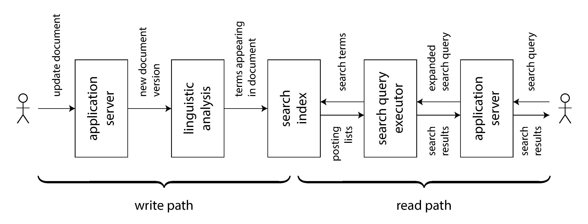

## Designing Data-Intensive Applications

### 12장. The Future of Data Systems

- 원문: 초판, 본문 pp. 489–544 / PDF pp. 511–566. 참고문헌은 PDF p. 567부터 시작함
- 핵심: 원본에서 파생 상태를 만들고, 정확성·변경 용이성·데이터 사용의 영향을 함께 설계함
- 정비 관점: 원본 작업 기록, 현재 장착 현황, 통계, 감사 자료를 같은 이력에서 만들고 서로 대조하는 문제와 유사함
- 이 장에는 2017년 당시 저자의 제안과 전망이 포함됨. 현재의 보편적 운영 규칙으로 단정하지 않음

 

#### Data Integration — 여러 도구의 데이터를 연결

- 저장·검색·분석·추천은 접근 패턴이 달라 하나의 도구가 모두에 최적이기는 어려움
- 여러 도구를 쓰면 같은 정보의 표현을 일관되게 유지하는 문제가 생김
- 원본과 파생 데이터의 관계를 먼저 정해야 함

##### Combining Specialized Tools by Deriving Data — 원본에서 다시 만들기

- system of record는 충돌·손실 시 판단 기준이 되는 authoritative source임
- derived data는 원본을 변환한 색인·cache·집계·모델 등임

###### Reasoning About Dataflows — 원본과 파생 경로 추적

- 원본 변경을 ordered log로 전달하면 독립된 dual write보다 변경 순서를 추적하기 쉬움
- 재시도·재생 시 같은 효과를 내려면 deterministic 변환과 idempotent 적용 등이 필요함

###### Derived Data Versus Distributed Transactions — 가시성 시점의 차이

- distributed transaction의 atomic commit과 비동기 파생 처리는 가시성 시점이 다름. 둘을 동일한 보장으로 취급하면 안 됨
- atomic commit 자체가 serializability나 linearizability를 자동 제공하는 것도 아님

###### The Limits of Total Ordering — 전역 순서의 비용

- 모든 event의 전역 순서를 하나로 정하면 규모·지역·offline 동작에서 병목이 될 수 있음

###### Ordering Events to Capture Causality — 필요한 의존 순서 보존

- 의존 관계가 있는 event의 causal order를 보존하고, 독립된 event는 분산 처리하는 접근을 검토할 수 있음
- 외부 알림처럼 되돌리기 어려운 효과가 있으면 순서가 뒤바뀐 뒤 단순히 재계산하는 것으로 해결되지 않음

##### Batch and Stream Processing — 과거 재계산과 새 변경 연결

- batch는 고정된 과거 입력, stream은 계속 들어오는 변경을 처리함
- 둘 다 입력에서 파생 상태를 만든다는 공통점이 있음

###### Maintaining Derived State — 새 변경으로 현재 view 갱신

- stream으로 현재 view를 갱신함. 끝나지 않는 입력을 처리하므로 operator state와 복구 지점을 관리해야 함

###### Reprocessing Data for Application Evolution — 과거 자료로 새 view 생성

- batch·replay로 새 구조를 만들거나 오류를 수정할 수 있음
- 새 view를 별도로 만든 뒤 일부 요청부터 전환하면 migration을 단계적으로 검토할 수 있음

###### The Lambda Architecture — 두 처리 경로의 결합

- lambda architecture는 batch layer와 speed layer를 병행함
- 빠른 최근 결과와 과거 재계산을 결합하지만 logic 중복과 결과 병합 비용이 생김

###### Unifying Batch and Stream Processing — 같은 logic으로 과거와 현재 처리

- 하나의 처리 logic으로 과거 replay와 새 event를 다루려면 재현 가능한 상태·시간·실패 처리 규칙이 필요함

 

#### Unbundling Databases — 내부 기능을 dataflow로 조합

- database 내부의 index·view·log·실행 기능을 여러 전문 도구로 나눠 연결하는 관점임
- 하나의 통합 제품이 요구를 충족하면 분해로 생기는 운영 비용이 더 클 수 있음

##### Composing Data Storage Technologies — 저장·조회 도구 연결

- database 내부의 secondary index 갱신도 원본 변경에서 파생 상태를 만드는 과정임
- 같은 원리를 database 밖의 검색 색인·warehouse·cache에 적용할 수 있음
- 비동기 log는 생산자와 소비자의 직접적인 대기를 줄이고, 팀 간 event interface를 제공함
- 소비자가 중단되면 뒤처진 변경을 따라잡을 수 있지만 보관 기간·적체·schema 변경을 관리해야 함

###### Unbundled Versus Integrated Systems — 조합의 이득과 운영 비용

- 분해한 시스템은 monitoring·배포·보안·장애 조사의 접점이 늘어남. 조합의 이득과 운영 비용을 비교해야 함

##### Designing Applications Around Dataflow — 변경에 반응하는 코드

###### Application Code as a Derivation Function — 변경을 상태로 변환

- application code를 “입력 변경에서 새 상태를 도출하는 함수”로 볼 수 있음
- 기준 정보가 바뀌면 이를 사용하는 색인·집계·화면 상태도 갱신하는 구조임

###### Separation of Application Code and State — 실행과 영속 상태 분리

- 코드 배포와 durable state 관리를 분리하되, state 변경의 전달·복구를 명확히 해야 함

###### Stream Processors and Services — 요청 조회와 변경 구독

- 매 요청마다 원격 서비스를 호출하는 대신 참조 정보의 변경을 구독해 local state로 유지할 수 있음
- 예를 들어 환율·부품 설명 정보를 event와 결합할 때 최신 값을 쓸지 당시 version을 쓸지 명시해야 함
- 동기 RPC는 즉시 답을 얻는 경로, stream은 지속적으로 상태를 전달하는 경로임. 지연과 오류의 노출 방식이 다름

##### Observing Derived State — 쓰기 경로와 읽기 경로

- write path는 원본 변경이 처리 단계를 거쳐 파생 상태에 반영되는 경로임
- read path는 query가 파생 상태를 읽어 결과를 만드는 경로임
- 미리 계산하는 범위를 늘리면 읽기는 빨라질 수 있지만 갱신 비용과 지연 관리가 늘어남

###### Stateful, Offline-Capable Clients — client까지 이어지는 상태

- 화면도 파생 상태의 소비자로 볼 수 있음. 변경 구독은 조회 결과를 계속 갱신하는 방식임
- offline client는 local state를 유지하고 나중에 동기화함. 충돌·version·재접속 복구가 필요함

###### Reads Are Events Too — 요청이 의존한 조회 상태

- 사용자가 본 상태와 이후 요청의 의존성을 함께 전달하면 read-your-writes와 인과관계 처리에 도움됨

###### Multi-Partition Data Processing — 조회·처리 단계의 완료 조건

- 여러 partition에 걸친 조회·처리도 중간 상태와 완료 조건을 정해야 함

 

#### Aiming for Correctness — 전체 경로의 정확성

- database가 transaction을 제공해도 잘못된 업무 코드·중복 요청·외부 효과는 남음
- 보장 범위를 client부터 최종 결과까지 연결해 검토해야 함

##### The End-to-End Argument for Databases — 끝단까지 작업 ID 유지

- TCP의 중복 제거는 한 연결 안의 전송을 다룸. 사용자의 재요청이 같은 업무인지까지 판단하지 못함
- database transaction도 새로운 요청으로 들어온 동일 업무를 자동 식별하지 못함
- client가 만든 request ID를 끝까지 전달하고, 같은 ID의 완료 여부와 실제 변경을 함께 기록하는 방법을 사용할 수 있음
- deduplication 기록과 효과가 따로 저장되면 그 사이의 crash에서 중복·누락이 발생할 수 있음
- 중복 판정 기간과 ID 충돌 처리도 정의해야 함. “재시도 가능”이라는 표현만으로 정확성이 확보되지는 않음

##### Enforcing Constraints — 같은 자원을 같은 판정 지점으로 보내기

- uniqueness는 같은 이름·자원을 요구하는 요청 중 무엇을 승인할지 결정하는 문제임
- 충돌 가능한 요청을 같은 partition으로 모아 순서대로 검사하면 판정 범위를 줄일 수 있음
- client는 결과를 기다려 최종 승인 여부를 알거나, 일단 pending으로 두고 나중에 결과를 받을 수 있음

###### Multi-Partition Request Processing — 여러 partition의 변경 연결

- 여러 partition에 걸친 작업은 durable한 요청에서 각 partition의 instruction을 만들고 ID로 중복을 제거하는 접근이 가능함
- 이 접근이 모든 변경을 같은 순간에 보이게 하는 것은 아님. 중간 상태·실패 복구·완료 조건을 별도로 정의해야 함
- 잔액·재고·예약 같은 제약은 서로 다른 규칙이 있음. 전달 보장만으로 업무 invariant가 자동 유지되지는 않음

##### Timeliness and Integrity — 늦음과 잘못됨 구분

| 속성 | 문제 | 필요한 대응 |
| --- | --- | --- |
| timeliness | 올바른 변경이 아직 보이지 않음 | 지연 축소, 대기, 진행 상태 표시 |
| integrity | 누락·중복·모순·잘못된 값 | 감지, 원인 수정, 대조·복구 |

- 시간이 지나면 정상적으로 따라잡는 지연과, 기다려도 고쳐지지 않는 손상을 구분해야 함
- 비동기 처리도 durable log·중복 방지·올바른 변환으로 integrity를 유지할 수 있음

###### Coordination-Avoiding Data Systems — 조정 범위 줄이기

- 모든 단계를 동기적으로 기다리게 하면 지연·장애가 더 넓게 전파될 수 있음
- 일부 업무는 사후 검증과 보정으로 조정을 줄일 수 있음. 즉시 보장이 필요한 제약과는 구분해야 함
- 정비 비유에서 통계 화면의 갱신 지연과 작업 기록 누락은 다른 문제임. 실제 안전 판단을 사후 보정으로 대체하자는 의미는 아님

##### Trust, but Verify — 보장을 독립적으로 확인

- 알고리즘은 저장·memory·CPU 등이 모델의 가정대로 동작한다고 전제함. 실제 환경에는 bug와 손상도 있음
- checksum은 일부 손상을 검출하고, 원본과 파생 상태의 대조는 logic 오류·누락을 찾는 데 도움됨
- backup은 존재 여부뿐 아니라 복구 가능한지 확인해야 함

###### Designing for Auditability — 입력부터 결과까지 대조

- audit 가능한 구조는 입력, 처리 version, 중간 근거, 최종 결과를 연결해 추적할 수 있어야 함
- 같은 잘못된 logic으로 결과를 다시 계산하는 것만으로 모든 오류를 찾을 수는 없음. 독립적인 대조 기준이 필요함

 

#### Doing the Right Thing — 데이터 사용이 만드는 영향

- 기술적으로 정확한 처리와 사람에게 정당한 사용은 다른 검토 대상임
- 책은 수집·예측·분류가 사용자에게 미치는 결과를 개발자의 책임에 포함함

##### Predictive Analytics — 분류 오류와 자기강화

- 예측은 상관관계에 기반할 수 있으며, 개인의 행동이나 능력을 확정적으로 설명하지는 못함
- false positive·false negative의 피해가 누구에게 돌아가는지 봐야 함
- 데이터 편향과 설명·이의제기의 부재는 불이익을 반복할 수 있음

###### Feedback Loops — 예측이 다음 관측을 바꾸는 문제

- 예측에 따라 기회나 관측을 바꾸면 다음 학습 데이터도 바뀜. feedback loop가 기존 차이를 강화할 수 있음
- 정비 데이터에서도 경고가 많은 장비를 더 자주 점검하면 결함 발견 건수가 함께 늘 수 있음. 관측·점검 빈도와 실제 상태를 구분해야 함

##### Privacy and Tracking — 수집 목적과 통제권

- 사용자가 의도적으로 맡긴 정보와 배경에서 추적한 활동 정보는 기대와 권력관계가 다름
- 긴 약관에 동의했다는 사실만으로 실제 선택권과 이해가 충분했다고 볼 수는 없음
- 데이터는 업무 개선뿐 아니라 감시·차별·유출에도 쓰일 수 있음
- 저자는 목적에 맞는 수집·보관, 불필요한 데이터 삭제, 사용 방식의 설명과 사용자 통제를 강조함
- 이는 책의 윤리적 논의임. 특정 국가의 현행 법률·보관 기간을 안내하는 내용은 아님

 

#### Summary — 정리

- 기준 원본과 파생 경로가 명확하면 재계산·변경·감사가 쉬워짐
- 비동기 처리는 최신성의 즉시 보장과 데이터 무결성을 분리해 설계하게 함
- 작업 ID와 대조·복구는 전체 경로의 정확성에 필요함
- 시스템의 신뢰성·확장성·유지보수성과 함께 데이터 사용의 결과도 검토해야 함
